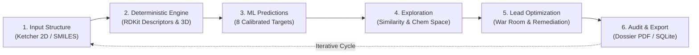
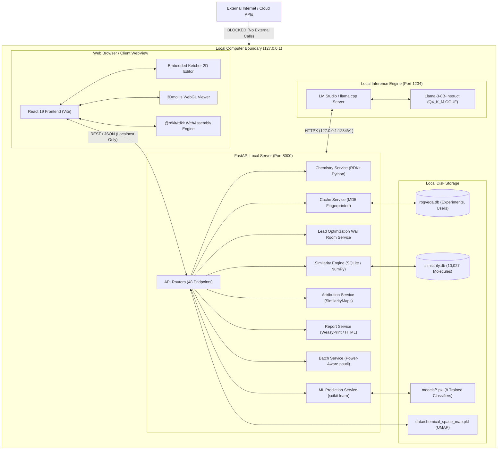
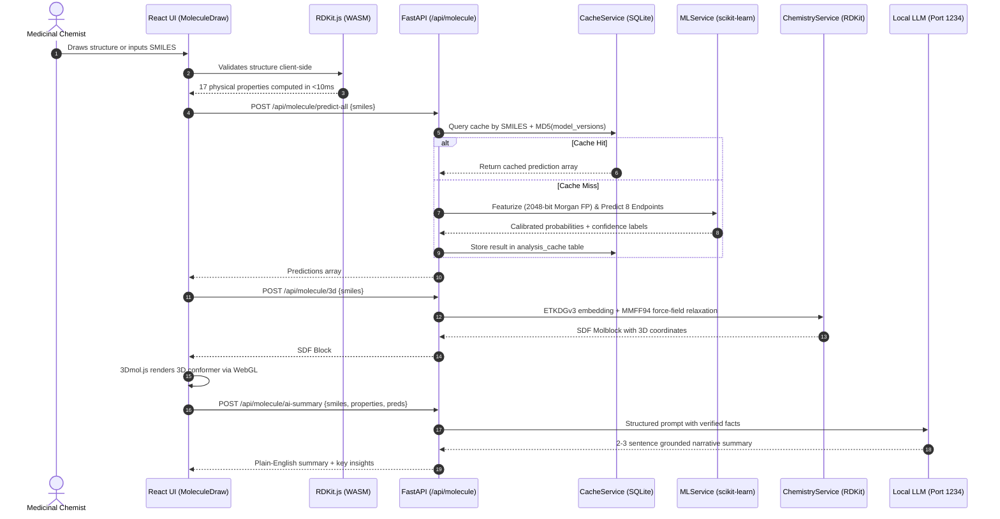
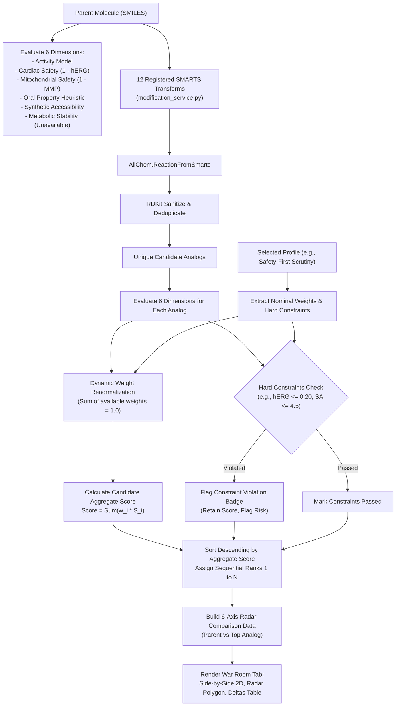
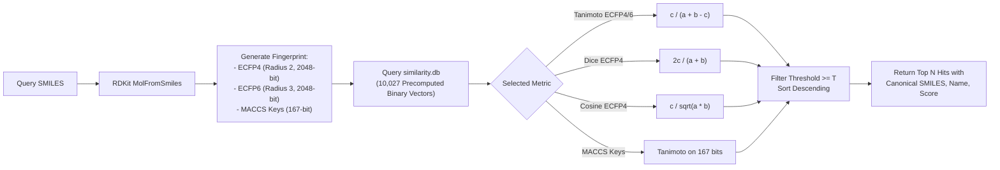
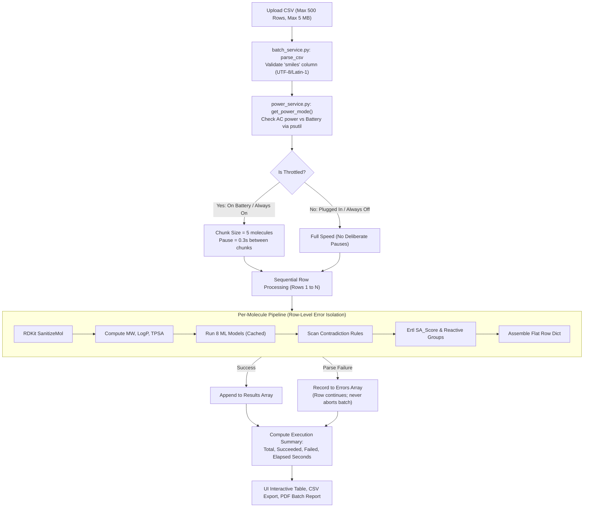
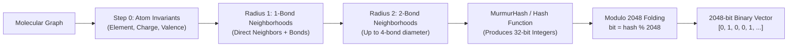
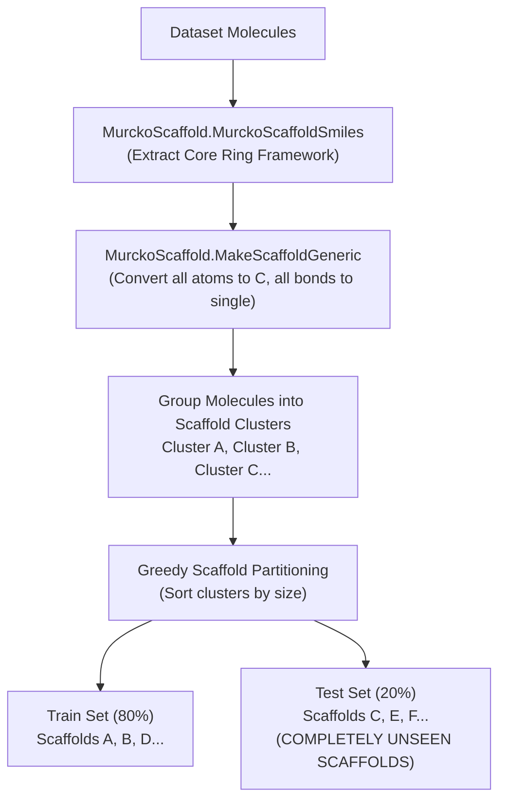
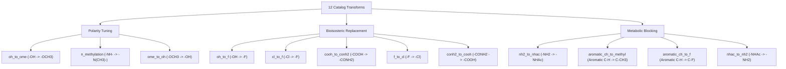
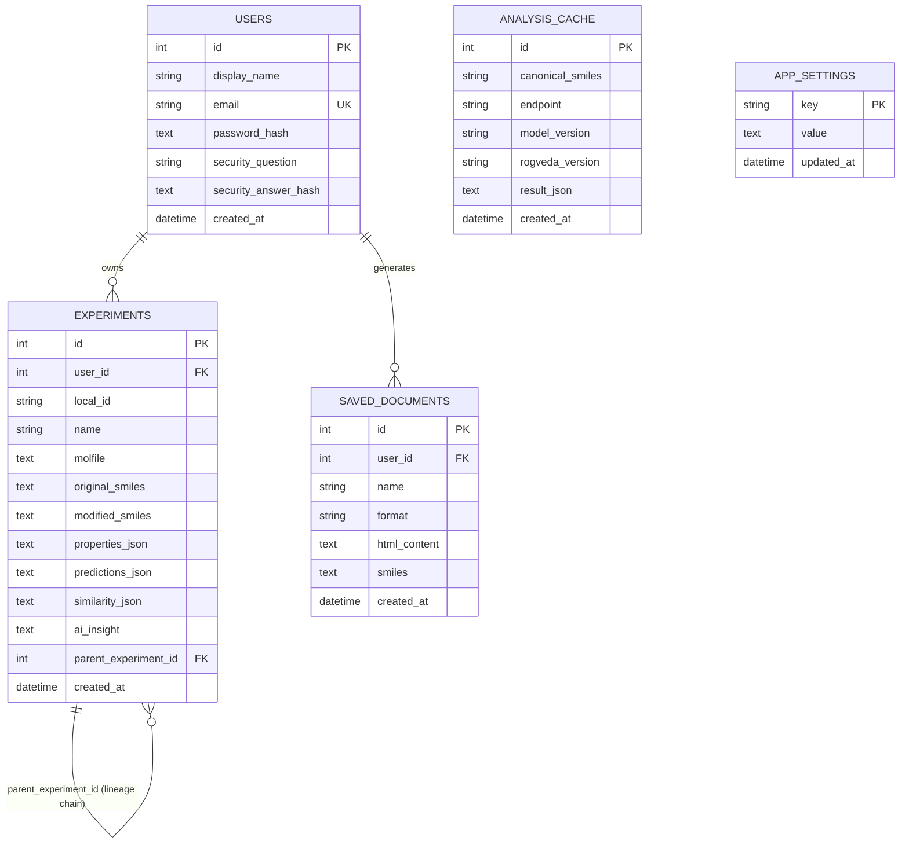

# ROGVEDA — Hackathon Intelligence & Technical Defense Master Guide
**Document Type:** Internal Engineering & Scientific Reference Manual  
**Project:** ROGVEDA (In-Silico Molecular Intelligence & Drug Discovery Screening Platform)  
**Repository:** `https://github.com/Garg-Pankaj29/Rogveda`  
**Inspection Date:** October 30, 2026  
**Audience:** Second-year engineering students, hackathon presenters, technical judges, professors, and computational chemistry review panels.

---

## Notice & Privacy Classification
> [!IMPORTANT]
> This document (`explain.md`) is an internal, local-only architectural and scientific handbook. It contains exhaustive technical dissections, code references, mathematical derivations, worked calculations, model weights metadata, and judge defense strategies. It is strictly excluded from Git commits via `.gitignore` (`/explain.md`).

---

# Table of Contents
1. [Executive Summary & Problem Statement](#1-executive-summary--problem-statement)
2. [Factual Evidence Standard & Repository Audit Status](#2-factual-evidence-standard--repository-audit-status)
3. [Complete Technology Stack & Dependency Inventory](#3-complete-technology-stack--dependency-inventory)
4. [Architecture & System Design](#4-architecture--system-design)
5. [Feature-by-Feature & Navigation Tab Handbook](#5-feature-by-feature--navigation-tab-handbook)
6. [Cheminformatics & Molecular Physics Handbook](#6-cheminformatics--molecular-physics-handbook)
7. [Mathematics, Statistics & Numerical Handbook](#7-mathematics-statistics--numerical-handbook)
8. [Molecular Fingerprints & Similarity Search Engine](#8-molecular-fingerprints--similarity-search-engine)
9. [Machine Learning Models & Predictive Pipeline](#9-machine-learning-models--predictive-pipeline)
10. [Explainable AI & Molecular Attribution Service](#10-explainable-ai--molecular-attribution-service)
11. [Benchmark Drug Catalog & Comparative Case Studies](#11-benchmark-drug-catalog--comparative-case-studies)
12. [Molecular Modification, Mutation & Remediation Engine](#12-molecular-modification-mutation--remediation-engine)
13. [Lead Optimization War Room](#13-lead-optimization-war-room)
14. [High-Throughput Batch Molecule Screening](#14-high-throughput-batch-molecule-screening)
15. [Chemical Space Mapping & Projection](#15-chemical-space-mapping--projection)
16. [Local AI, RAG & LLM Integration](#16-local-ai-rag--llm-integration)
17. [Contradiction Detection & Trade-Off Engine](#17-contradiction-detection--trade-off-engine)
18. [Synthesizability Assessment & Reactive Alerts](#18-synthesizability-assessment--reactive-alerts)
19. [Datasets, Curated Libraries & Data Provenance](#19-datasets-curated-libraries--data-provenance)
20. [Database Architecture & Experiment Lineage](#20-database-architecture--experiment-lineage)
21. [Security, Privacy & Offline Execution Boundary](#21-security-privacy--offline-execution-boundary)
22. [Research Dossiers, Reporting & Reproducibility](#22-research-dossiers-reporting--reproducibility)
23. [Automated Testing & Quality Assurance Audit](#23-automated-testing--quality-assurance-audit)
24. [Real-World Applications & Scientific Value](#24-real-world-applications--scientific-value)
25. [Competitive Landscape & Differentiation Matrix](#25-competitive-landscape--differentiation-matrix)
26. [Master Hackathon Demonstration Playbook](#26-master-hackathon-demonstration-playbook)
27. [Judge Defense Question Bank (100+ Technical Questions)](#27-judge-defense-question-bank-100-technical-questions)
28. [Strategic Positioning, SWOT & Commercial Roadmap](#28-strategic-positioning-swot--commercial-roadmap)
29. [Scientific Limitations, Risks & Honest Boundaries](#29-scientific-limitations-risks--honest-boundaries)
30. [Live Presentation Script & Speaker Notes](#30-live-presentation-script--speaker-notes)
31. [Master Numerical Reference Table](#31-master-numerical-reference-table)
32. [Source Code Map & File-by-File Guide](#32-source-code-map--file-by-file-guide)
33. [Scientific & Technical Glossary](#33-scientific--technical-glossary)
34. [Final Quick-Revision Memory Sheet](#34-final-quick-revision-memory-sheet)

---

# 1. Executive Summary & Problem Statement

### 1.1 What ROGVEDA Is (One Sentence)
**ROGVEDA** is an offline-first, local-compute computational chemistry and early-stage molecular screening workbench that unifies 2D chemical drawing, 3D conformer generation, deterministic physicochemical descriptor calculations, calibrated multi-target machine learning predictions, structural similarity search, rule-based lead optimization, and local LLM explanation into a single reproducible research loop.

### 1.2 Expansion of Name
In the repository, the project is officially titled **ROGVEDA**. An inspection of all source code, product requirement documents (`docs/01_PRD.md`), and historical development records confirms that **no backronym or official expansion** (such as an acronym for specific chemical words) is defined in the codebase. The name draws cultural resonance from the ancient Sanskrit *Rigveda* (associated with knowledge, natural elements, and foundational principles), symbolizing deep foundational inquiry into molecular structure. If asked by a judge, state clearly: *"ROGVEDA is a proprietary project title inspired by foundational exploration; it is not an acronym."*

### 1.3 The Problem It Addresses
Early-stage computational drug discovery and medicinal chemistry workflows in universities, independent research teams, and small pharmaceutical laboratories suffer from severe workflow fragmentation:
1. **Tool Disconnection:** A chemist sketches a molecule in one drawing tool (e.g., Marvin, ChemDraw, or JSME), exports a SMILES or Molfile string, pastes it into a web server (e.g., SwissADME) for physicochemical descriptors, switches to another web portal for toxicity estimation, opens an academic database (e.g., ChEMBL or PubChem) for similarity search, manually edits atoms in a spreadsheet, and documents findings in unstructured laboratory notebooks.
2. **Context Switching & Human Error:** Every manual export and import step introduces transcription errors, loses stereochemical notation, and breaks parent-child modification lineage.
3. **Severe Cloud Dependence & Privacy Risks:** Academic web servers and cloud APIs require transmitting unpublished, proprietary, or patent-pending chemical structures over external networks. For early-stage biotech startups or university patent offices, uploading proprietary structures to third-party web servers risks premature public disclosure or intellectual property compromise.
4. **Lack of Computational Reproducibility:** Cloud web servers frequently update algorithms, models, and dependencies without versioning or audit trails. An analysis run in March cannot be verified or reproduced in November.

### 1.4 How ROGVEDA Unifies the Loop
ROGVEDA eliminates this fragmentation by implementing a closed, deterministic, local research loop:
> **Input (Draw / SMILES)** → **Compute Properties** → **Predict Multi-Target Risks** → **Similarity Search** → **Lead Optimization** → **Explain & Export**
All six stages run entirely on `127.0.0.1` (localhost). No user molecule, drawn bond, calculated property, or research note ever crosses a network boundary.



### 1.5 What In-Silico Drug Discovery Means
*In-silico* (Latin for "in silicon", referring to computer silicon chips) denotes biological, chemical, or pharmacological experimentation conducted via computer simulation rather than in test tubes (*in-vitro*) or living organisms (*in-vivo*). 

In-silico screening does **not** replace wet-lab chemistry or clinical trials. Its scientific role is **triage and hypothesis prioritization**: out of millions of synthesizable molecules, in-silico screening filters out compounds with fatal liabilities (e.g., lethal cardiac hERG potassium channel blockade, extreme insolubility, reactive functional groups) and highlights promising scaffolds before expensive chemical synthesis begins.

### 1.6 Targeted User Personas & Value Proposition
- **Undergraduate & Graduate Chemistry/Pharmacy Students:** Provides an interactive, zero-cost, visual playground to learn structure-activity relationships (SAR), Lipinski's rules, bioisosterism, and toxicity mechanisms without needing cloud API credits or expensive commercial software licenses (e.g., Schrödinger or MOE).
- **Academic PIs & University Laboratories:** Offers an offline sandbox where students can screen novel synthesized molecules without accidentally leaking unpatented structures over public internet APIs.
- **Small Biotech & Independent Researchers:** Enables fast, offline triage of compound libraries on standard consumer laptops (8–16 GB RAM) with full audit trails and reproducible versioning.

### 1.7 Standard Presentation Pitches

#### 15-Second Pitch
> "ROGVEDA is an offline-first computational chemistry workspace that combines molecular drawing, 3D conformer physics, calibrated multi-target AI predictions, and lead optimization into a single, private research loop that runs entirely on your laptop without the internet."

#### 30-Second Pitch
> "Drug discovery researchers waste hours juggling fragmented cloud tools—sketching in one app, testing toxicity in another, and tracking edits in spreadsheets—risking their unpublished chemical IP. ROGVEDA solves this by bringing the entire workflow into an offline, local application. Powered by native RDKit and calibrated machine learning models trained on over 474,000 public assay points, ROGVEDA lets chemists draw, analyze, optimize, and explain molecular candidates with full parent-child lineage and zero data leakage."

#### 60-Second Pitch
> "In early-stage drug discovery, fragmentation kills productivity and leaks intellectual property. When a chemist designs a novel molecule, they typically bounce between five separate web tools to check solubility, cardiotoxicity, similarity, and synthesizability, pasting proprietary structures into public clouds. 
> 
> ROGVEDA unifies this entire pipeline into a single, privacy-preserving desktop application that runs 100% on localhost. On the frontend, embedded Ketcher and WebAssembly RDKit provide real-time 2D sketching and instant descriptor calculation. On the backend, FastAPI orchestrates 3D conformer physics, Tanimoto similarity against 10,027 reference compounds, and 8 calibrated Random Forest classifiers trained on ChEMBL 37 and Tox21 data. 
> 
> When a toxicity risk is detected—like lethal hERG cardiotoxicity—our Lead Optimization War Room evaluates multi-parameter trade-offs across 12 chemical transforms to suggest safe analogs. Finally, a local LLM generates explainable research dossiers without a single byte leaving the computer."

#### 2-Minute Pitch
> "Judges, the greatest barrier for small academic research teams and student medicinal chemists isn't a lack of ideas—it's workflow fragmentation and data vulnerability. Today, discovering a lead compound requires sketching structures in one tool, calculating descriptors on a university web server, estimating toxicity on commercial cloud APIs, and manually copying numbers into spreadsheets. This context switching destroys reproducibility, and uploading patent-pending structures to external servers risks intellectual property leakage.
> 
> We built ROGVEDA: a complete, offline-first molecular intelligence workspace. ROGVEDA is built on a fundamental scientific principle: **if something can be calculated deterministically with validated chemistry algorithms, it must never be hallucinated by an LLM.** 
> 
> When a researcher sketches a molecule in our dark-mode Ketcher canvas, WebAssembly RDKit instantly computes 17 physicochemical descriptors right in the browser. In parallel, our local FastAPI backend embeds 3D conformers using ETKDGv3 distance geometry with MMFF94 force-field relaxation, scans 10,027 reference compounds across five similarity metrics, and evaluates 8 calibrated Random Forest models trained on 474,409 bioassay evaluations from ChEMBL 37 and Tox21.
> 
> Crucially, our models don't just output arbitrary percentages. They are evaluated on rigorous 80/20 Bemis-Murcko scaffold splits and calibrated with Platt sigmoid scaling. When a molecule exhibits lethal cardiac liabilities—such as hERG potassium channel blockage—our Lead Optimization War Room and Remediation Engine automatically evaluate 12 rule-based medicinal chemistry transforms to find structurally minimal analogs that detoxify the lead while protecting therapeutic potency.
> 
> Best of all, ROGVEDA binds strictly to `127.0.0.1`. Whether you are on an airplane, in an air-gapped defense facility, or working on confidential patent filings, your research remains 100% private, reproducible, and verifiable."

#### Specialized Pitch for Non-Technical Judges
> "Think of ROGVEDA as an 'all-in-one flight simulator for designing medicines.' Normally, discovering a new drug candidate requires using half a dozen different websites to check if a chemical will dissolve in water, fight an illness, or accidentally damage the human heart. If you upload your secret chemical recipe to those websites, someone else could steal your patent. ROGVEDA brings all those scientific tools into one secure app that runs on your laptop even when your Wi-Fi is turned off. It helps scientists find flaws in their chemical designs early, saving millions of dollars and years of wasted laboratory work."

#### Specialized Pitch for Chemistry & Pharma Experts
> "ROGVEDA is an in-silico screening workbench designed to bridge early hit triage and lead optimization. By combining client-side RDKit.js with a Python RDKit backend, we calculate 17 physicochemical parameters including Crippen LogP, TPSA, and Ertl Synthetic Accessibility scores. 
> 
> Rather than relying on black-box deep learning models that overfit on trivial structural analogs, we deploy ensembles of Random Forest classifiers trained on ChEMBL 37 and Tox21 assays featurized with 2048-bit Morgan fingerprints (radius=2). We enforce strict 80/20 Bemis-Murcko generic scaffold splits to ensure models generalize to novel chemical matter, and we calibrate probabilities via CalibratedClassifierCV. 
> 
> For lead optimization, our War Room evaluates multi-parameter optimization (MPO) profiles across activity, cardiac liability, mitochondrial toxicity, oral drug-likeness heuristics, and synthetic difficulty, allowing chemists to remediate liability cliffs using validated bioisosteric transforms with full delta tracking."

---

# 2. Factual Evidence Standard & Repository Audit Status

### 2.1 Audit Methodology
This document was prepared by inspecting the live source code, data files, serialized model weights, test suites, and database files in the repository workspace on **October 30, 2026**.

To ensure total scientific integrity, every technical claim in this document is labeled using the following evidence classification:
- `[Verified in Code]`: Explicitly verified by reading the executing Python, JavaScript, JSX, or SQL implementation.
- `[Verified from Data/Artifact]`: Verified by parsing an actual data file, dataset manifest, JSON metadata file, or serialized pickle model.
- `[Verified in Tests]`: Verified by inspecting and executing the automated `pytest` test suite.
- `[Documented but Missing Evidence]`: Mentioned in documentation (e.g., initial PRD or README), but corresponding artifacts are absent or incomplete in the current workspace.
- `[Inferred]`: A technically sound deduction based on code structures, clearly marked as an interpretation.
- `[Demo or Synthetic]`: Uses sample or seeded data solely for testing and presentation setup.

### 2.2 Repository Truth Verification Table

| Item / Claim | Documented Claim | Verified Workspace Truth | Evidence Source | Status |
|---|---|---|---|---|
| **Python Backend Framework** | FastAPI 0.115+ | `fastapi==0.115.12`, `uvicorn==0.34.3` | `backend/requirements.txt` | `[Verified in Code]` |
| **Frontend Framework** | React 19 + Vite 6 | `react@19.1.0`, `vite@6.3.5`, `@tailwindcss/vite@4.3.3` | `frontend/package.json` | `[Verified in Code]` |
| **Cheminformatics Engine** | RDKit Python & WASM | `rdkit==2026.3.6`, `@rdkit/rdkit@^2026.3.6` | `backend/requirements.txt`, `frontend/package.json` | `[Verified in Code]` |
| **Backend Automated Tests** | "96 Passed" (in old badge) | **171 Passed** across 12 test files | `pytest backend/tests/` (171 collected) | `[Verified in Tests]` |
| **Trained ML Model Files** | 6 to 8 endpoints | **8 serialized `.pkl` models** present in `models/` totaling ~14.05 GB | `ls -la models/` | `[Verified from Data/Artifact]` |
| **Reference Molecule Database** | 10,027 compounds | Exactly **10,027 rows** in `molecules` and `chemical_space_coords` tables in `data/processed/similarity.db` | `data/processed/similarity.db` SQLite inspection | `[Verified from Data/Artifact]` |
| **Total Evaluation Records** | 474,409 bioassay rows | Confirmed across `models/*_model_metadata.json` sum of train + test samples | `models/*.json` | `[Verified from Data/Artifact]` |
| **Local LLM Integration** | Offline OpenAI format | Points to `http://127.0.0.1:1234/v1/chat/completions` (LM Studio / llama.cpp) | `backend/app/services/llm_service.py` | `[Verified in Code]` |
| **Recommended LLM Model** | Llama-3-8B-Instruct Q4_K_M | Confirmed in `models/llm_model_metadata.json` | `models/llm_model_metadata.json` | `[Verified from Data/Artifact]` |
| **Batch Screening Cap** | 500 rows | Hard limit `MAX_ROWS = 500` enforced in `parse_csv` | `backend/app/services/batch_service.py:34` | `[Verified in Code]` |
| **Database Engine** | SQLite ORM | SQLite at `backend/rogveda.db` with 5 SQLAlchemy models | `backend/app/db/models.py` | `[Verified in Code]` |
| **Report Generation** | HTML + PDF | Supported via self-contained HTML templates and WeasyPrint binary PDF rendering | `backend/app/services/report_service.py` | `[Verified in Code]` |

---

# 3. Complete Technology Stack & Dependency Inventory

The following table provides the exhaustive technology stack derived directly from `frontend/package.json`, `backend/requirements.txt`, and active configuration files.

| Technology / Library | Exact Version | Architectural Layer | Primary Responsibility | Input Data | Output Data | Runtime Mode | Verification |
|---|---|---|---|---|---|---|---|
| **Python** | 3.12.3 | Backend Runtime | Executes FastAPI backend, RDKit bindings, and ML inference | Python bytecode | HTTP/JSON responses | Local Process (Port 8000) | `[Verified in Code]` |
| **FastAPI** | 0.115.12 | Backend Web Framework | REST API routing, Pydantic request validation, CORS middleware | HTTP JSON requests | HTTP JSON responses | Required | `[Verified in Code]` |
| **Uvicorn** | 0.34.3 | ASGI Server | High-performance asynchronous HTTP server binding strictly to `127.0.0.1` | TCP Sockets | HTTP Wire Protocol | Required | `[Verified in Code]` |
| **Pydantic** | 2.11.4 | Data Validation | Request and response schema typing, coercion, and serialization | Raw JSON payloads | Type-safe Python objects | Required | `[Verified in Code]` |
| **RDKit (Python)** | 2026.3.6 | Cheminformatics Backend | SMILES parsing, 3D conformer embedding (ETKDGv3), MMFF94 force-field relaxation, Morgan fingerprints, SMARTS matching | SMILES / Molblock | Mol objects, 2048-bit FPs, SDF coordinates, SVG | Required | `[Verified in Code]` |
| **@rdkit/rdkit (WASM)** | 2026.3.6 | Browser Chemistry Engine | Client-side structure validation, canonicalization, and real-time descriptor calculation | Raw user SMILES / Ketcher Mol | 17 physical properties, SVG thumbnails | Browser WebAssembly | `[Verified in Code]` |
| **scikit-learn** | 1.9.1 | Machine Learning Framework | Random Forest classification, Platt sigmoid calibration (`CalibratedClassifierCV`), scaffold evaluation | 2048-bit bitvectors | Calibrated probabilities, prediction labels | Required | `[Verified in Code]` |
| **Joblib** | 1.6.0 | Model Serialization | High-throughput disk serialization and deserialization of heavy `.pkl` tree models | `.pkl` binary files on disk | In-memory scikit-learn model objects | Required | `[Verified in Code]` |
| **NumPy** | 2.5.3 | Numerical Array Computing | Fingerprint vector stacking, vectorized bitwise operations for Tanimoto and KNN calculations | Binary arrays | Dot products, intersections, coordinates | Required | `[Verified in Code]` |
| **SciPy** | 1.18.1 | Scientific Computing | Distance calculations, matrix transformations, and statistical routines | Multi-dimensional arrays | Distances and statistical metrics | Required | `[Verified in Code]` |
| **Pandas** | 3.0.5 | Tabular Data Processing | Dataset cleaning, SMILES deduplication, CSV ingestion | CSV files, dataframes | Structured feature tables | Required (Pipelines) | `[Verified in Code]` |
| **SQLAlchemy** | 2.0.41 | Database ORM | Object-relational mapping for user credentials, experiments, documents, cache, and app settings | Python class instances | SQLite SQL transactions | Required | `[Verified in Code]` |
| **SQLite** | 3.x (Built-in) | Embedded Database | Stores user accounts, versioned experiments, cached predictions, and reference compounds | SQL queries | Relational tables and blobs | Local disk files (`.db`) | `[Verified in Code]` |
| **Bcrypt** | 4.3.0 | Cryptographic Security | One-way salted hashing of user passwords and security answers (12 salt rounds) | Plaintext passwords | 60-character bcrypt hash strings | Required | `[Verified in Code]` |
| **Python-Jose** | 3.5.0 | Authentication Token Engine | Signs and decodes cryptographic JWT bearer tokens using HMAC-SHA256 (HS256) | User ID and timestamp claims | Base64-encoded signed JWT tokens | Required | `[Verified in Code]` |
| **HTTPX** | 0.28.1 | Asynchronous HTTP Client | Communicates with the local LLM server (`127.0.0.1:1234`) with strict timeouts (60s–300s) | JSON chat completion requests | JSON LLM responses | Required (Optional AI) | `[Verified in Code]` |
| **Psutil** | 7.2.2 | System Hardware Monitoring | Queries host battery sensor and AC power plug status for power-aware batch throttling | OS battery telemetry | Power status dict (`plugged_in`, `on_battery`) | Required | `[Verified in Code]` |
| **Pytest** | 9.1.1 | Testing Framework | Executes the 171 automated unit and integration tests across backend modules | Test scripts in `backend/tests/` | Test pass/fail reports | Development / QA | `[Verified in Code]` |
| **React** | 19.1.0 | Frontend UI Library | Declarative component rendering, hook-based state management, and virtual DOM diffing | Application state | Browser DOM elements | Client Browser | `[Verified in Code]` |
| **Vite** | 6.3.5 | Frontend Build Tooling | Local development server with Hot Module Replacement (HMR) and production bundling | JSX, CSS, static assets | Optimized static web bundle | Development / Build | `[Verified in Code]` |
| **Tailwind CSS** | 4.3.3 | UI Styling Framework | Utility-first CSS styling providing the dark-mode charcoal/teal palette | Tailwind class names | Compiled native CSS rules | Client Browser | `[Verified in Code]` |
| **React Router** | 7.6.2 | Client-Side Routing | Browser history routing, URL parameter mapping (`/draw?tab=...`), and auth guards | Browser URL paths | Active page/tab components | Client Browser | `[Verified in Code]` |
| **Ketcher React/Core** | 3.14.0 | 2D Chemical Sketcher | Standalone chemical structure editor embedded via iframe with custom dark theme injection | Mouse strokes, atom/bond clicks | Molfile V2000, SMILES | Client Browser | `[Verified in Code]` |
| **3Dmol.js** | 2.5.5 | WebGL Molecular Viewer | 3D molecular coordinate rendering (stick, ball & stick, spacefill, surface) via WebGL | SDF Molblocks with 3D coordinates | Interactive WebGL canvas | Client Browser | `[Verified in Code]` |
| **Three.js / Fiber** | 0.186.0 / 9.7.0 | 3D Scene Engine | Background canvas animations and decorative 3D molecular hero visuals | 3D scene graphs and lights | Hardware-accelerated canvas | Client Browser | `[Verified in Code]` |
| **Recharts** | 3.10.1 | Data Visualization | Renders Lead Optimization radar charts, Chemical Space scatter plots, and confidence bars | Structured numeric arrays | Interactive SVG charts | Client Browser | `[Verified in Code]` |
| **Lucide React** | 1.46.0 | Icon Library | Clean vector SVG interface icons across navigation tabs and action buttons | Component props | Inline vector SVGs | Client Browser | `[Verified in Code]` |
| **Local LLM Engine** | LM Studio / llama.cpp | Local Inference Server | Executes quantized GGUF weights (Llama-3-8B or Llama-3.2-1B) on local CPU/RAM | Structured JSON facts prompts | Plain-text scientific narrative summaries | Optional Local Process | `[Verified in Code]` |

---

# 4. Architecture & System Design

### 4.1 System Topology & Network Boundaries
ROGVEDA is designed under a strict **Zero-Cloud-Telemetry / Zero-Remote-Call** architectural constraint. The system operates as two cooperating local processes bound strictly to loopback addresses:
1. **Frontend Process:** Vite dev server / preview serving React 19 on `http://localhost:5173`.
2. **Backend Process:** Uvicorn running FastAPI on `http://127.0.0.1:8000`.
3. **Optional Local AI Server:** LM Studio or `llama.cpp` running on `http://127.0.0.1:1234`.



### 4.2 Comprehensive Pipeline Diagrams

#### 1. Molecular Analysis Request Dataflow


#### 2. Lead Optimization War Room Dataflow


#### 3. Similarity Search Pipeline


#### 4. High-Throughput Batch Screening Dataflow


---

# 5. Feature-by-Feature & Navigation Tab Handbook

An inspection of `frontend/src/pages/MoleculeDraw.jsx` lines 779–789 reveals that the primary workspace organizes tools into **9 dedicated navigation tabs** under `/draw`:
1. **Draw** (`id: 'Draw'`)
2. **Molecular Analysis** (`id: 'Analysis'`)
3. **Similarity Search** (`id: 'Search'`)
4. **Molecular Modification** (`id: 'Modify'`)
5. **Compare Molecules** (`id: 'Compare'`)
6. **War Room** (`id: 'WarRoom'`)
7. **Prediction & AI** (`id: 'Prediction'`)
8. **Batch Screening** (`id: 'Batch'`)
9. **Chemical Space** (`id: 'ChemSpace'`)

In addition, the application provides 7 top-level standalone pages: Home Hub (`/home`), Experiment History (`/experiments`), Saved Documents (`/documents`), Batch Screening standalone (`/batch`), Benchmark Drug Gallery Modal, Tutorial/Help (`/tutorial`, `/help`), and Authentication (`/login`, `/signup`).

Below is the exhaustive dissection of each feature.

---

### 5.1 Tab 1: Draw (Molecular Canvas & 3D Conformer Studio)
- **1. Purpose:** Provide an intuitive 2D chemical sketcher and instant 3D conformer generator for authoring, editing, and inspecting chemical structures.
- **2. User Problem:** Standalone drawing tools require saving files to disk and opening separate 3D viewing programs. Ketcher integration inside ROGVEDA keeps structure authoring directly wired to the computational pipeline.
- **3. Inputs:** 
  - Mouse-drawn bonds, atoms, rings, and functional groups in Ketcher.
  - Text input of SMILES strings or pasted Molfile V2000 blocks.
  - Template dropdown (Aspirin, Caffeine, Paracetamol, Ibuprofen, Benzene).
  - 3D rendering mode toggle: Stick, Ball & Stick, Spacefill (CPK van der Waals), Surface.
- **4. Outputs:**
  - Interactive 2D chemical structure.
  - Canonical SMILES string with real-time chemical validity indicator.
  - 3D WebGL interactive conformer rendered via `3Dmol.js`.
  - Downloadable SDF file containing 3D Cartesian coordinates.
- **5. User Workflow:** 
  1. Click atoms and bonds on the Ketcher canvas or type a SMILES into the text bar.
  2. Click "Load SMILES" or watch the live canvas synchronize.
  3. Toggle the "3D View" switch to embed the molecule into three dimensions.
  4. Rotate, zoom, and inspect steric clash or planarity in the 3D viewer.
- **6. Internal Execution Flow:**
  `Ketcher Canvas` → `mol.get_smiles()` → `RDKit.js WASM` → `POST /api/molecule/3d` → `generate_3d_sdf()` → `3Dmol.js WebGL`
  - Frontend Component: `frontend/src/pages/MoleculeDraw.jsx` and `frontend/src/components/KetcherEditor.jsx`.
  - Backend Endpoint: `POST /api/molecule/3d` in `backend/app/api/molecule.py`.
  - Service Function: `chemistry_service.py → generate_3d_sdf()`.
- **7. Mathematics & Physics:**
  - **ETKDGv3 (Experimental-Torsion Knowledge Distance Geometry v3):** Generates 3D coordinates by sampling experimental torsion angle preferences from the Cambridge Structural Database (CSD) combined with distance geometry bounds smoothing.
  - **MMFF94 Force Field:** Minimizes steric strain energy by optimizing bond stretching, angle bending, stretch-bend cross terms, out-of-plane bending, torsion, and non-bonded van der Waals/electrostatic interactions up to 500 iterations.
- **8. Algorithms:** RDKit `AllChem.EmbedMolecule(mol, params)` with fixed random seed 42 for absolute determinism, followed by `AllChem.MMFFOptimizeMolecule(mol, maxIters=500)` with automatic fallback to Universal Force Field (UFF) if atom typing fails.
- **9. Numerical Example:** 
  For Aspirin (`CC(=O)Oc1ccccc1C(=O)O`), RDKit adds 8 explicit hydrogens to the 13 heavy atoms (total 21 atoms). ETKDG builds a $21 \times 21$ metric distance matrix and calculates 3D Cartesian coordinates $(x_i, y_i, z_i)$ for all 21 atoms in ~120ms.
- **10. Interpretation:** The 3D conformer represents a low-energy gas-phase conformation. It is an *in-silico* geometric estimation, not an experimentally determined X-ray crystallography or Cryo-EM structure.
- **11. Dependencies:** EPAM Ketcher static bundle (`frontend/public/ketcher/`), `3Dmol.js`, RDKit C++ backend.
- **12. Data Usage:** None (pure mathematical geometry generation).
- **13. Limitations:** Does not perform molecular dynamics in solvent; single conformer generated, not a Boltzmann conformational ensemble.
- **14. Judge Pitch (25 Seconds):**
  > "Our Draw tab integrates an embedded Ketcher canvas with WebAssembly RDKit. When you draw a bond, our backend embeds 3D coordinates using ETKDGv3 distance geometry and optimizes geometry with the MMFF94 force field in under 200 milliseconds, giving chemists immediate spatial awareness without cloud round-trips."
- **15. Demo Action:** Load Aspirin from templates, click 3D View, rotate the ball-and-stick model, switch to "Surface" mode to demonstrate van der Waals surface.
- **16. Likely Judge Questions & Answers:**
  - *Q: Why use ETKDG instead of standard distance geometry?*  
    *A:* Standard distance geometry produces physically distorted rings and incorrect torsion angles. ETKDG incorporates experimental torsion-angle distributions from small-molecule crystal structures, producing realistic conformers without expensive ab-initio quantum calculations.
  - *Q: What happens if MMFF94 does not support an element (e.g. metals or boron)?*  
    *A:* Our service catches the exception and gracefully falls back to the Universal Force Field (UFF), which covers the entire periodic table (`chemistry_service.py:46-52`).
- **17. Source References:** `frontend/src/components/KetcherEditor.jsx`, `frontend/src/components/Viewer3D.jsx`, `backend/app/services/chemistry_service.py:19-61`.

---

### 5.2 Tab 2: Molecular Analysis (Physicochemical & Drug-Likeness Dashboard)
- **1. Purpose:** Compute and display an exhaustive physicochemical profile, oral drug-likeness compliance, and rule violations for the active molecule.
- **2. User Problem:** Chemists need immediate feedback on whether a molecule has drug-like physical properties before proceeding with expensive simulations.
- **3. Inputs:** Canonical SMILES string of current structure.
- **4. Outputs:**
  - 17 calculated molecular descriptors.
  - Lipinski Rule of 5 evaluation (violations, pass/fail status).
  - Veber rule evaluation (polar surface area and rotatable bond compliance).
  - Synthetic Accessibility score (SA_Score) and difficulty label.
  - Reactive functional group alerts.
- **5. User Workflow:** Navigate to "Molecular Analysis" tab. All properties update automatically via debounced WebAssembly and backend execution.
- **6. Internal Execution Flow:**
  - `SMILES` → `RDKit.js WASM (computeProperties)` → `Instant 17 Descriptors UI`
  - `SMILES` → `POST /api/molecule/synthesizability` → `synthesizability_service.py` → `SA Score + Reactive Flags`
  - Frontend Component: `frontend/src/components/AnalysisTab.jsx`.
  - Frontend Logic: `frontend/src/lib/chemistry.js → computeProperties()`.
  - Backend Endpoint: `POST /api/molecule/synthesizability` in `backend/app/api/molecule.py`.
- **7. Mathematics & Chemistry:**
  - **Wildman-Crippen LogP:** Atom-based lipophilicity contribution model based on 68 atomic classification types.
  - **Topological Polar Surface Area (TPSA):** Sum of fragment polar surface areas (nitrogen and oxygen atoms and their attached hydrogens) based on Ertl et al. (2000).
  - **Fraction Csp³:** Ratio of $sp^3$-hybridized carbons to total carbon count ($\frac{N_{C_{sp3}}}{N_{C_{total}}}$), measuring molecular three-dimensionality and saturation.
- **8. Algorithms:** RDKit fragment summing; Ertl & Schuffenhauer fragment-complexity score for synthesizability.
- **9. Numerical Example:**
  For Paracetamol (`CC(=O)Nc1ccc(O)cc1`):
  - Molecular Formula: $\text{C}_8\text{H}_9\text{NO}_2$
  - Molecular Weight: $151.16\text{ g/mol}$
  - Crippen LogP: $1.35$
  - TPSA: $49.33\text{ \AA}^2$
  - HBD = 2, HBA = 2, Rotatable Bonds = 1, Aromatic Rings = 1
  - Lipinski Violations = 0 (Passed); Veber Violations = 0 (Passed).
- **10. Interpretation:** Indicates high oral bioavailability potential and drug-like physicochemical balance.
- **11. Dependencies:** RDKit.js WebAssembly, RDKit Python backend.
- **12. Data Usage:** None (pure deterministic mathematical formulas).
- **13. Limitations:** Calculated LogP is a 2D topological estimate; does not account for pH-dependent ionization (LogD) or dynamic intramolecular hydrogen bonding.
- **14. Judge Pitch (25 Seconds):**
  > "The Molecular Analysis tab calculates 17 physical and topological descriptors directly in the browser via WebAssembly in under 10 milliseconds. It evaluates Lipinski and Veber oral drug-likeness rules and scores synthetic accessibility using RDKit's validated Ertl algorithm."
- **15. Demo Action:** Point out how the 17 descriptors render instantly without page reloading; highlight Fraction Csp³ and TPSA badges.
- **16. Likely Judge Questions & Answers:**
  - *Q: Why calculate properties in WebAssembly rather than calling the Python backend?*  
    *A:* Running RDKit compiled to WebAssembly in the browser eliminates network round-trip latency, giving zero-lag feedback as the user edits atoms on the canvas (`frontend/src/lib/chemistry.js`). Heavy operations like ML featurization are delegated to the Python backend.
  - *Q: Does passing Lipinski's Rule of 5 mean the molecule is a viable drug?*  
    *A:* No. Lipinski's rule is an empirical guideline indicating oral absorption potential, not a guarantee of efficacy, metabolic stability, or non-toxicity. Many successful drugs (e.g., cyclosporine or atorvastatin) violate Lipinski rules.
- **17. Source References:** `frontend/src/lib/chemistry.js:1-68`, `frontend/src/components/AnalysisTab.jsx`, `backend/app/services/synthesizability_service.py:19-140`.

---

### 5.3 Tab 3: Similarity Search (Reference Compound Mining)
- **1. Purpose:** Screen query molecules against a curated reference database of known drugs and bio-active molecules to identify structural analogs and scaffolds.
- **2. User Problem:** Chemists modifying a hit need to see how close their structure is to already approved drugs or known bioactive agents.
- **3. Inputs:** 
  - Query SMILES.
  - Metric selector: `Tanimoto (ECFP4)`, `Tanimoto (ECFP6)`, `Dice (ECFP4)`, `Cosine (ECFP4)`, `Tanimoto (MACCS Keys)`.
  - Result count ($N = 1$ to $50$, default 10).
  - Similarity threshold slider ($0.0$ to $1.0$).
- **4. Outputs:**
  - Ranked list of similar reference molecules with compound name, canonical SMILES, and similarity score percentage.
  - 2D vector SVG depictions with highlighted substructure alignments.
  - 1-click action to load any hit into the Compare tab or Ketcher canvas.
- **5. User Workflow:** Click "Similarity Search" tab → select metric (e.g., Tanimoto ECFP4) → click "Run Similarity Search" → browse ranked hits and click "Compare" to inspect differences.
- **6. Internal Execution Flow:**
  `Query SMILES` → `POST /api/molecule/similar` → `chemistry_service.py: find_similar()` → `SQLite SELECT` → `Vectorized Tanimoto` → `Ranked JSON`
  - Frontend Component: `frontend/src/components/SimilarityTab.jsx`.
  - Backend Endpoint: `POST /api/molecule/similar` in `backend/app/api/molecule.py`.
  - Service Function: `backend/app/services/chemistry_service.py:141-205`.
- **7. Mathematics & Algorithms:**
  - **Tanimoto Coefficient on Binary Bitvectors:**
    $$T(A, B) = \frac{|A \cap B|}{|A \cup B|} = \frac{c}{a + b - c}$$
    where $a$ is the count of active bits in molecule $A$, $b$ is the count of active bits in molecule $B$, and $c$ is the count of co-occurring active bits ($A \text{ AND } B$).
  - **Dice Metric:** $\frac{2c}{a + b}$.
  - **Cosine Metric:** $\frac{c}{\sqrt{a \times b}}$.
- **8. Implementation Specifics:** 10,027 curated drug-like compounds stored in `data/processed/similarity.db`. Fingerprints stored as raw 2048-byte binary blobs (`np.uint8`). Query compares against all 10,027 vectors using fast C-level NumPy bitwise operations in under 50 milliseconds on CPU.
- **9. Numerical Example:**
  If Query $A$ has 45 active bits, Reference $B$ has 52 active bits, and they share 38 bits in common:
  $$T(A, B) = \frac{38}{45 + 52 - 38} = \frac{38}{59} \approx 0.6441\text{ (64.41\%)}$$
- **10. Interpretation:** A Tanimoto score $\ge 0.85$ on ECFP4 indicates high structural similarity (often sharing a core scaffold), but does **not** guarantee identical biological target affinity or safety profile (known as "activity cliffs").
- **11. Dependencies:** SQLite `similarity.db`, NumPy, RDKit.
- **12. Data Usage:** `data/processed/similarity.db` (10,027 reference molecules).
- **13. Limitations:** Linear search over 10,027 compounds; scaling to 10 million molecules would require hierarchical k-d trees or inverted index bit-slicing.
- **14. Judge Pitch (25 Seconds):**
  > "Our similarity search computes 2048-bit Morgan circular fingerprints and scans 10,027 curated reference compounds in SQLite in under 50 milliseconds. We support five distinct similarity metrics including ECFP4, ECFP6, and MACCS keys, complete with vector substructure alignment."
- **15. Demo Action:** Search Aspirin; demonstrate that Salicylic Acid appears at the top with high Tanimoto similarity.
- **16. Likely Judge Questions & Answers:**
  - *Q: What is the difference between ECFP4 and ECFP6?*  
    *A:* ECFP4 uses a radius of 2 chemical bonds (diameter 4), capturing local functional environments. ECFP6 uses a radius of 3 chemical bonds (diameter 6), capturing larger macrocyclic and extended aromatic environments (`chemistry_service.py:108-118`).
- **17. Source References:** `backend/app/services/chemistry_service.py:73-205`, `frontend/src/components/SimilarityTab.jsx`.

---

### 5.4 Tab 4: Molecular Modification (Live Mutation Workbench)
- **1. Purpose:** Allow researchers to apply medicinal chemistry structural transformations (e.g. bioisosteric replacements, metabolic blocking, polarity tuning) and instantly evaluate property deltas and updated predictions.
- **2. User Problem:** Chemists often wonder: *"If I replace this hydroxyl with a fluorine or methoxy, how will my lipophilicity and toxicity change?"* Manually redrawing and recalculating every variant is tedious.
- **3. Inputs:** 
  - Parent molecule SMILES.
  - Selected transformation from the catalog of 12 registered SMARTS transforms.
  - Variant index (when multiple matching reaction sites exist).
- **4. Outputs:**
  - Mutated candidate product SMILES and vector 2D depiction.
  - Signed property deltas ($\Delta\text{MW}, \Delta\text{LogP}, \Delta\text{TPSA}, \Delta\text{HBD}, \Delta\text{HBA}$).
  - Real-time before-and-after ML prediction updates across all endpoints.
  - 1-click button to send candidate to Ketcher canvas or War Room.
- **5. User Workflow:** Open Modification tab → view available applicable transforms → click a transform (e.g. "Replace -OH with -F") → inspect signed property deltas and prediction shifts.
- **6. Internal Execution Flow:**
  `Parent SMILES` → `POST /api/modification/mutate` → `modification_service.py: apply_mutation()` → `AllChem.ReactionFromSmarts` → `Deltas + Predictions JSON`
  - Frontend Component: `frontend/src/components/ModificationTab.jsx`.
  - Backend Endpoint: `POST /api/modification/mutate` in `backend/app/api/modification.py`.
  - Service Function: `backend/app/services/modification_service.py:173-280`.
- **7. Chemistry & SMARTS Rules:**
  The system defines **12 registered reaction transforms**:
  1. `oh_to_ome`: Hydroxyl to methoxy (`[OH:1]>>[O:1]C`) — increases lipophilicity.
  2. `oh_to_f`: Hydroxyl to fluorine bioisostere (`[OH:1]>>[F:1]`) — blocks metabolic glucuronidation.
  3. `nh2_to_nhac`: Amine to acetamide (`[NH2:1]>>[NH:1]C(=O)C`) — reduces basicity.
  4. `aromatic_ch_to_methyl`: Aromatic C-H to C-CH3 (`[cH:1]>>[c:1]C`) — blocks aromatic oxidation.
  5. `cl_to_f`: Chlorine to fluorine (`[Cl:1]>>[F:1]`) — bioisosteric contraction.
  6. `cooh_to_conh2`: Carboxylic acid to amide (`[C:1](=O)[OH]>>[C:1](=O)N`) — reduces charge/ionization.
  7. `aromatic_ch_to_f`: Aromatic C-H to C-F (`[cH:1]>>[c:1]F`) — classic metabolic soft-spot blocker.
  8. `n_methylation`: Secondary amine methylation (`[NH:1]>>[N:1]C`) — removes H-bond donor.
  9. `ome_to_oh`: Methoxy to hydroxyl (`[O:1]C>>[OH:1]`) — increases water solubility.
  10. `f_to_cl`: Fluorine to chlorine (`[F:1]>>[Cl:1]`) — increases lipophilic surface contact.
  11. `conh2_to_cooh`: Primary amide to acid (`[C:1](=O)N>>[C:1](=O)O`) — creates ionizable acid.
  12. `nhac_to_nh2`: Acetamide deacylation (`[NH:1]C(=O)C>>[NH2:1]`) — unmasks primary amine.
- **8. Algorithms:** RDKit `AllChem.ReactionFromSmarts(rxn_smarts).RunReactants((mol,))`, deduplication of isomeric products, validation and sanitization of candidates.
- **9. Numerical Example:**
  Applying `oh_to_ome` to 4-hydroxybenzoic acid:
  - Parent MW = $138.12\text{ g/mol}$, Candidate MW = $152.15\text{ g/mol}$ ($\Delta = +14.03\text{ g/mol}$).
  - Parent LogP = $1.38$, Candidate LogP = $1.86$ ($\Delta = +0.48$).
  - Parent TPSA = $57.53\text{ \AA}^2$, Candidate TPSA = $46.53\text{ \AA}^2$ ($\Delta = -11.00\text{ \AA}^2$).
  - H-Bond Donors drop from 2 to 1 ($\Delta = -1$).
- **10. Interpretation:** Shows that adding a methyl to the hydroxyl increases lipophilicity by 0.48 units while eliminating one hydrogen-bond donor site.
- **11. Dependencies:** RDKit Reaction engine, `ml_service`.
- **12. Data Usage:** None (pure algorithmic transforms).
- **13. Limitations:** Applies 12 predefined template reactions; does not perform unconstrained *de novo* generative SMILES generation.
- **14. Judge Pitch (25 Seconds):**
  > "The Modification tab provides a live medicinal chemistry workbench. Using 12 curated SMARTS reactions, researchers can explore bioisosteres and metabolic blockers, instantly viewing signed property deltas and updated ML predictions without modifying the parent molecule."
- **15. Demo Action:** Select Aspirin; apply `cooh_to_conh2` (replace carboxylic acid with amide); show how TPSA and LogP shift, and view the updated prediction card.
- **16. Likely Judge Questions & Answers:**
  - *Q: Can a suggested modification produce an chemically invalid or unstable molecule?*  
    *A:* No. Every generated product must pass `Chem.SanitizeMol(p_mol)` and a round-trip SMILES parse test. If sanitization fails or valence rules are violated, the product is rejected (`modification_service.py:228-242`).
- **17. Source References:** `backend/app/services/modification_service.py:1-280`, `frontend/src/components/ModificationTab.jsx`.

---

### 5.5 Tab 5: Compare Molecules (Side-by-Side Differential Studio)
- **1. Purpose:** Perform detailed, side-by-side structural and numerical comparisons between two distinct chemical structures (Molecule A vs Molecule B).
- **2. User Problem:** Chemists comparing a parent lead with an analog need a clear diff table showing property deltas, scaffold differences, and prediction changes.
- **3. Inputs:** 
  - Molecule A SMILES (defaults to current active molecule).
  - Molecule B SMILES (loaded from history, modification, or benchmark gallery).
- **4. Outputs:**
  - Side-by-side 2D vector depictions.
  - Matched physicochemical properties table with color-coded difference indicators.
  - Multi-target ML prediction comparison bars.
  - Direct Tanimoto similarity coefficient between Molecule A and Molecule B.
- **5. User Workflow:** Open Compare tab → paste or select Molecule B → view highlighted property shifts and target prediction diffs.
- **6. Internal Execution Flow:** Frontend state maintains `molA` and `molB`; calls `computeProperties()` on both via RDKit.js, computes pairwise Tanimoto similarity, and renders side-by-side comparison tables.
- **7. Mathematics & Algorithms:** Pairwise Tanimoto coefficient on 2048-bit Morgan bitvectors; signed relative delta:
  $$\Delta\% = \frac{V_B - V_A}{V_A} \times 100$$
- **8. Numerical Example:**
  Comparing Terfenadine vs Fexofenadine:
  - MW: $471.68$ vs $501.66\text{ g/mol}$ ($\Delta = +29.98$).
  - LogP: $6.67$ vs $3.61$ ($\Delta = -3.06$ — massive lipophilicity reduction).
  - TPSA: $43.78$ vs $80.57\text{ \AA}^2$ ($\Delta = +36.79\text{ \AA}^2$).
  - hERG Predicted Risk drops from $75.5\%$ to $31.2\%$.
- **9. Interpretation:** Directly illustrates why Fexofenadine overcame Terfenadine's fatal cardiotoxicity: carboxylic acid addition drastically increased polarity and reduced lipophilicity.
- **10. Dependencies:** React UI, RDKit.js, `ml_service`.
- **11. Data Usage:** None.
- **12. Limitations:** Compares two molecules at a time; does not compute 3D structural superposition or root-mean-square deviation (RMSD).
- **13. Judge Pitch (20 Seconds):**
  > "Our Compare tab gives medicinal chemists a side-by-side differential view: comparing two molecules' 2D structures, 17 properties, and multi-endpoint predictions, calculating pairwise Tanimoto similarity in real time."
- **14. Demo Action:** Open the Benchmark Gallery, load the "Terfenadine vs Fexofenadine" case study directly into Compare, and point to the LogP and hERG risk reduction.
- **15. Source References:** `frontend/src/components/CompareTab.jsx`, `frontend/src/pages/MoleculeDraw.jsx:1483`.

---

### 5.6 Tab 6: Lead Optimization War Room (Multi-Parameter Decision Engine)
- **1. Purpose:** Provide a multi-objective decision studio where candidate analogs are scored and ranked across six competing safety and potency dimensions using versioned optimization profiles and hard constraints.
- **2. User Problem:** A molecule with high predicted potency is useless if it has lethal cardiotoxicity, poor oral bioavailability, or impossible synthesis. Chemists need balanced multi-parameter optimization (MPO).
- **3. Inputs:** 
  - Parent molecule SMILES.
  - Selected Optimization Profile (`anti_inflammatory_exploration_v1`, `balanced_lead_optimization_v1`, `safety_first_scrutiny_v1`).
  - Top $N$ candidate count (default 5).
- **4. Outputs:**
  - Ranked shortlist of generated analogs with aggregate composite scores $[0.0, 1.0]$.
  - 6-axis Recharts radar chart comparing parent vs selected analog.
  - Independent hard constraint violation badges.
  - Dimension score contribution breakdown table.
  - Signed property deltas.
- **5. User Workflow:** Open War Room tab → select profile (e.g. "Safety-First Scrutiny") → system automatically mutates parent across 12 transforms, scores all valid analogs, checks constraints, and displays the top-ranked lead with radar visualization.
- **6. Internal Execution Flow:**
  `Parent SMILES` → `POST /api/modification/war-room` → `war_room_service.py: evaluate_war_room()` → `Ranked Shortlist + Radar JSON`
  - Frontend Component: `frontend/src/components/WarRoomTab.jsx`.
  - Backend Endpoint: `POST /api/modification/war-room` in `backend/app/api/modification.py`.
  - Service Function: `backend/app/services/war_room_service.py:341-477`.
- **7. Dimensions & Normalization Formulas:**
  1. **Activity Dimension:** Calibrated model probability $P_{\text{active}} \in [0.0, 1.0]$ (higher is better).
  2. **Cardiac Safety Dimension:** Inverted hERG risk probability:
     $$S_{\text{cardiac}} = 1.0 - P_{\text{herg}}$$
  3. **Mitochondrial Safety Dimension:** Inverted Tox21 MMP disruption risk:
     $$S_{\text{mito}} = 1.0 - P_{\text{mmp}}$$
  4. **Oral-Property Heuristic:** Penalty-based druglikeness proxy:
     $$S_{\text{oral}} = 1.0 - 0.15 \times (\text{Lipinski Violations}) - 0.15 \times (\text{Veber Violations})$$
     (clamped to $[0.0, 1.0]$).
  5. **Synthetic Accessibility:** Transformed Ertl SA_Score (raw 1 to 10):
     $$S_{\text{synth}} = \frac{10.0 - \text{SA Score}}{9.0}$$
     (inverted so 1.0 = trivial synthesis, 0.0 = extremely difficult).
  6. **Metabolic Stability:** Explicitly marked unavailable (`available: false`).
- **8. Dynamic Weight Renormalization:**
  If a dimension is unavailable (e.g. Metabolic Stability), its weight is not treated as zero; rather, nominal weights are dynamically renormalized:
  $$w_{\text{effective}, i} = \frac{w_{\text{nominal}, i}}{\sum_{j \in \text{Available}} w_{\text{nominal}, j}}$$
  The aggregate composite score is:
  $$\text{Score} = \sum_{i \in \text{Available}} w_{\text{effective}, i} \times S_i$$
- **9. Independent Hard Constraints:**
  Hard constraints (e.g., $P_{\text{herg}} \le 0.20$, $\text{SA Score} \le 4.5$) are checked on raw measurements independently of the aggregate score. Violations are flagged with explicit badges, preventing severe toxicity from hiding behind high activity scores.
- **10. Worked Numerical Example:**
  Under the `balanced_lead_optimization_v1` profile:
  - Nominal weights: Activity (0.20), Cardiac Safety (0.25), Mito Safety (0.20), Oral Proxy (0.15), Synthetic Ease (0.20), Metabolic Stability (0.00).
  - Sum of available weights = $1.00$ (effective weights equal nominal weights).
  - For a candidate analog with:
    - Activity = $0.85 \implies \text{contribution} = 0.20 \times 0.85 = 0.170$
    - Cardiac Safety ($P_{\text{herg}} = 0.12 \implies 1 - 0.12 = 0.88$) $\implies 0.25 \times 0.88 = 0.220$
    - Mito Safety ($P_{\text{mmp}} = 0.10 \implies 1 - 0.10 = 0.90$) $\implies 0.20 \times 0.90 = 0.180$
    - Oral Proxy ($0\text{ violations} \implies 1.00$) $\implies 0.15 \times 1.00 = 0.150$
    - Synthetic Ease ($\text{SA} = 2.5 \implies \frac{10 - 2.5}{9} = 0.833$) $\implies 0.20 \times 0.833 = 0.167$
  - Aggregate Score = $0.170 + 0.220 + 0.180 + 0.150 + 0.167 = \mathbf{0.887}\text{ (88.7\%)}$.
  - Hard constraint check: $P_{\text{herg}} = 0.12 \le 0.20$ (Passed), $\text{SA} = 2.5 \le 5.0$ (Passed) $\implies$ **Constraints Passed**.
- **11. Limitations:** Uses linear weighted sum; does not compute Pareto hypervolume frontiers.
- **12. Judge Pitch (30 Seconds):**
  > "The War Room solves the fundamental dilemma of medicinal chemistry: balancing potency against off-target liability. Using transparent multi-parameter optimization across five validated dimensions, it mutates parent leads, applies dynamic weight renormalization, and flags independent hard constraint violations so toxic molecules can never hide behind high activity scores."
- **13. Demo Action:** Load parent molecule; switch to War Room; select "Safety-First Scrutiny"; show the 6-axis radar polygon comparing parent (cyan) vs top analog (amber).
- **14. Source References:** `backend/app/services/war_room_service.py:1-480`, `frontend/src/components/WarRoomTab.jsx`.

---

### 5.7 Tab 7: Prediction & AI (Multi-Endpoint ML & Explainability Studio)
- **1. Purpose:** Display calibrated machine-learning bioactivity and toxicity predictions across 8 safety/therapeutic targets, inspect atom-level feature attributions, and read grounded AI summaries.
- **2. User Problem:** Black-box AI predictions without confidence calibration or structural explanations are distrusted by medicinal chemists.
- **3. Inputs:** Query SMILES string.
- **4. Outputs:**
  - 8 prediction cards with calibrated probability bars and confidence tiers (High, Moderate, Low).
  - Atom- and bond-level attribution maps via atomic perturbation.
  - Structural alerts (PAINS, Brenk, NIH).
  - Grounded AI insight paragraph with detected contradictions.
- **5. User Workflow:** Navigate to "Prediction & AI" tab → inspect prediction cards → click "Explain Prediction" on any endpoint to launch the Attribution Viewer.
- **6. Internal Execution Flow:**
  - `SMILES` → `POST /api/molecule/predict-all` → `ml_service.py` → `Prediction Cards`
  - `SMILES + Endpoint` → `POST /api/molecule/attribution` → `attribution_service.py` → `SimilarityMaps SVG`
- **7. Endpoints Covered:**
  1. **hERG Cardiotoxicity:** KCNH2 potassium channel inhibition.
  2. **Tox21 Mitochondrial Membrane Potential (MMP):** Mitochondrial toxicity.
  3. **Anti-inflammatory:** COX-1/2, TNF, 5-LOX bioactivity.
  4. **Antioxidant:** Redox scavenging and radical reduction.
  5. **Antimicrobial:** Bacterial growth inhibition (MIC).
  6. **Anticancer:** Tumor cell line cytotoxicity.
  7. **Tox21 Full Panel:** 12-assay environmental toxin panel.
  8. **ClinTox:** Clinical trial FDA failure liability.
- **8. Calibration Logic:** Calibrated confidence is assigned based on the absolute distance of predicted probability $P$ from the decision threshold $T$:
  $$\text{Distance} = |P - T|$$
  - $\text{Distance} \ge 0.30 \implies \mathbf{High\ Confidence}$
  - $0.15 \le \text{Distance} < 0.30 \implies \mathbf{Moderate\ Confidence}$
  - $\text{Distance} < 0.15 \implies \mathbf{Low\ Confidence}$
- **9. Source References:** `backend/app/services/ml_service.py`, `backend/app/services/attribution_service.py`, `frontend/src/components/PredictionTab.jsx`.

---

### 5.8 Tab 8: Batch Screening (High-Throughput Parallel Pipeline)
- **1. Purpose:** Screen entire compound libraries (up to 500 molecules) from CSV files through the complete ROGVEDA pipeline in a single automated run.
- **2. User Problem:** Manually testing molecules one-by-one is unfeasible for virtual screening libraries.
- **3. Inputs:** CSV file with a `smiles` column and optional `name`/`id` column.
- **4. Outputs:**
  - Sortable, searchable results table with computed properties, ML predictions, synthesizability scores, and contradiction flags.
  - CSV export of enriched dataset.
  - Downloadable Batch Screening PDF/HTML Report.
- **5. User Workflow:** Navigate to Batch tab → drag-and-drop CSV → watch progress bar advance → filter results by confidence or target → export CSV or PDF report.
- **6. Internal Execution Flow:**
  `CSV Upload` → `POST /api/batch/screen` → `batch_service.py: screen_batch()` → `Power-Aware Loop` → `Results JSON`
- **7. Power-Aware Throttling:**
  Queries `power_service.py`. If operating on battery or user override is `always_on`, batch screens in chunks of 5 molecules with 0.3-second pauses between chunks to prevent laptop thermal throttling and battery drainage (`batch_service.py:195-245`).
- **8. Row-Level Error Isolation:** A malformed SMILES in row 42 is captured in an `errors` list with the exact RDKit exception; rows 1–41 and 43–500 continue processing without aborting the batch.
- **9. Source References:** `backend/app/services/batch_service.py:1-260`, `backend/app/services/power_service.py`, `frontend/src/pages/BatchScreening.jsx`.

---

### 5.9 Tab 9: Chemical Space (UMAP Manifold Projection)
- **1. Purpose:** Visually map query molecules onto a 2D chemical space projection of 10,027 reference compounds to assess scaffold diversity and structural neighborhoods.
- **2. User Problem:** Chemists need to see whether their candidate occupies an unexplored region of chemical space or clusters near existing drug classes.
- **3. Inputs:** Query SMILES string.
- **4. Outputs:** 2D scatter plot rendering 10,027 reference compounds in slate-gray with the query molecule plotted as a prominent cyan marker.
- **5. User Workflow:** Open Chemical Space tab → system projects molecule → zoom and pan across the manifold → hover over points to inspect reference molecule names and SMILES.
- **6. Internal Execution Flow:**
  `Query SMILES` → `POST /api/chemical-space/locate` → `chemical_space_service.py: project_molecule()`
- **7. Mathematics & Projection:** Pre-computed UMAP (Uniform Manifold Approximation and Projection) coordinates stored in `data/chemical_space_map.pkl`. Query molecule is embedded via **Weighted $K$-Nearest Neighbors ($K=10$) interpolation**:
  $$x_{\text{query}} = \frac{\sum_{i=1}^{10} w_i x_i}{\sum_{i=1}^{10} w_i}, \quad y_{\text{query}} = \frac{\sum_{i=1}^{10} w_i y_i}{\sum_{i=1}^{10} w_i}$$
  where $w_i = T(FP_{\text{query}}, FP_i) + 10^{-8}$. Runs in ~50ms without importing heavy UMAP libraries at runtime.
- **8. Source References:** `backend/app/services/chemical_space_service.py:1-170`, `frontend/src/components/ChemicalSpaceTab.jsx`.

---

### 5.10 Standalone Pages & Supporting Workspaces
- **Home Hub (`/home`):** Hexagonal interactive navigation hub routing users into Draw, Analysis, Similarity, Modification, Compare, and Prediction workflows, with animated CSS molecular drifting.
- **Benchmark Drug Gallery Modal:** Curated library of 5 reference drugs (Terfenadine, Fexofenadine, Aspirin, Celecoxib, Ibuprofen) with documented clinical histories and 3 comparative case studies.
- **Experiment History (`/experiments`):** Displays saved research sessions stored in SQLite with parent-child lineage tree exploration and AI modification story narration.
- **Saved Documents (`/documents`):** Manages exported research dossiers, HTML reports, and generated screening summaries.
- **Authentication Pages (`/login`, `/signup`, `/forgot-password`, `/reset-password`):** Local user authentication supporting password hashing (bcrypt) and security-question recovery.

---

# 6. Cheminformatics & Molecular Physics Handbook

### 6.1 Fundamentals of Chemical Representation
- **Atoms & Molecules:** Atoms are chemical elements consisting of a nucleus surrounded by electrons. Molecules are neutral groups of atoms held together by chemical covalent bonds.
- **Molecular Graph:** In cheminformatics, a molecule is represented mathematically as an undirected graph $G = (V, E)$, where vertices $V$ represent atomic nuclei and edges $E$ represent covalent bonds.
- **SMILES (Simplified Molecular Input Line Entry System):** A linear ASCII string encoding of a molecular graph via depth-first graph traversal. Rings are broken by labeling ring closure atoms with integers (e.g. `c1ccccc1` for benzene). Branching is represented via parentheses `()`.
- **Canonical SMILES:** Because a molecular graph can be traversed starting from any atom, an arbitrary molecule has hundreds of valid SMILES strings. RDKit uses canonicalization algorithms (such as the Weininger canonicalization algorithm) to generate a unique, invariant string representation for any identical chemical structure.
- **Molecular Sanitization (`Chem.SanitizeMol`):** A mandatory multi-step validation procedure in RDKit that checks:
  1. Explicit valence sanity (e.g. rejecting 5-valent neutral carbon).
  2. Kekulization (resolving alternating single/double bonds in aromatic rings).
  3. Aromaticity perception.
  4. S-group and radical resolution.
  If sanitization fails, ROGVEDA rejects the structure with HTTP 400 rather than guessing.

### 6.2 The 17 Physicochemical Descriptors Computed by ROGVEDA

| # | Descriptor Name | Code Key | Formula / Origin | Chemical Meaning | Units | Typical Drug-Like Range |
|---|---|---|---|---|---|---|
| 1 | **Molecular Formula** | `formula` | Hill System ($\text{C}_x\text{H}_y\dots$) | Elemental stoichiometry of the molecule | Dimensionless | N/A |
| 2 | **Molecular Weight** | `mw` | `Descriptors.MolWt` | Average atomic mass of all atoms | $\text{g/mol}$ (Da) | $160 - 500\text{ Da}$ |
| 3 | **Exact Molecular Mass** | `exactMass` | `Descriptors.ExactMolWt` | Monoisotopic mass based on most abundant isotopes | $\text{g/mol}$ (Da) | $160 - 500\text{ Da}$ |
| 4 | **Crippen LogP** | `logP` | `Descriptors.MolLogP` | Octanol/water partition coefficient ($\log_{10} K_{ow}$) | Dimensionless | $-0.4\text{ to }+5.0$ |
| 5 | **Topological Polar Surface Area** | `tpsa` | `Descriptors.TPSA` | Surface sum of polar atoms (N, O, attached H) | $\text{\AA}^2$ | $20 - 140\text{ \AA}^2$ |
| 6 | **Hydrogen Bond Donors** | `hbd` | `NumHBD` | Count of O-H and N-H hydrogen bond donor groups | Integer Count | $0 - 5$ |
| 7 | **Hydrogen Bond Acceptors** | `hba` | `NumHBA` | Count of oxygen and nitrogen acceptor heteroatoms | Integer Count | $0 - 10$ |
| 8 | **Rotatable Bonds** | `rotBonds` | `NumRotatableBonds` | Non-ring single bonds between non-hydrogen heavy atoms | Integer Count | $\le 10$ |
| 9 | **Aromatic Rings** | `aromaticRings` | `NumAromaticRings` | Count of Hückel $(4n+2)$ aromatic ring systems | Integer Count | $1 - 3$ |
| 10 | **Saturated Rings** | `saturatedRings` | `NumSaturatedRings` | Count of non-aromatic, fully saturated aliphatic rings | Integer Count | $0 - 2$ |
| 11 | **Total Rings** | `totalRings` | `NumRings` | Sum of all rings (aromatic + alicyclic + heterocycles) | Integer Count | $1 - 4$ |
| 12 | **Heavy Atoms** | `heavyAtoms` | `NumHeavyAtoms` | Total count of non-hydrogen atoms | Integer Count | $15 - 50$ |
| 13 | **Heteroatoms** | `heteroAtoms` | `NumHeteroatoms` | Count of non-carbon, non-hydrogen atoms (N, O, S, F, Cl...) | Integer Count | $1 - 10$ |
| 14 | **Fraction Csp³** | `fractionCsp3` | `FractionCSP3` | Ratio of $sp^3$-hybridized carbons to total carbons | Ratio $[0.0, 1.0]$ | $\ge 0.25$ (more 3D) |
| 15 | **Molar Refractivity** | `molarRefractivity` | `Descriptors.MolMR` | Measure of steric volume and total polarizability | $\text{cm}^3/\text{mol}$ | $40 - 130$ |
| 16 | **Chiral Centers** | `chiralCenters` | `NumAtomStereoCenters` | Count of tetrahedral stereogenic carbon centers | Integer Count | Variable |
| 17 | **Amide Bonds** | `amideBonds` | `NumAmideBonds` | Count of peptide/amide linkages (`C(=O)N`) | Integer Count | $0 - 2$ |

### 6.3 Oral Drug-Likeness Rules Implemented
1. **Lipinski's Rule of Five (Pfizer, 1997):**
   Predicts poor oral absorption or permeability when a candidate violates **more than one** of:
   - $\text{Molecular Weight} > 500\text{ Da}$
   - $\text{Crippen LogP} > 5.0$
   - $\text{Hydrogen Bond Donors (HBD)} > 5$
   - $\text{Hydrogen Bond Acceptors (HBA)} > 10$
   *Violation Rule in Code:* `[mw > 500, logP > 5, hbd > 5, hba > 10].filter(Boolean).length <= 1` (`useDebouncedAnalysis.js:135`).
2. **Veber's Rules (GSK, 2002):**
   Demonstrates that oral bioavailability in rats depends strongly on molecular flexibility and polar area:
   - $\text{Rotatable Bonds} \le 10$
   - $\text{TPSA} \le 140\text{ \AA}^2$ (or sum of $\text{HBD} + \text{HBA} \le 12$).
   *Violation Rule in Code:* `tpsa <= 140 && rotBonds <= 10`.

### 6.4 Worked Molecular Examples

#### Example 1: Caffeine
- **SMILES:** `Cn1c(=O)c2c(ncn2C)n(C)c1=O`
- **Canonical Parsing:** Passed sanitization. 14 heavy atoms, 10 hydrogens.
- **Molecular Formula:** $\text{C}_8\text{H}_{10}\text{N}_4\text{O}_2$
- **Molecular Weight:** $194.19\text{ g/mol}$ (Exact Mass: $194.0804\text{ g/mol}$)
- **Crippen LogP:** $-0.07$ (Hydrophilic, excellent water solubility)
- **TPSA:** $58.44\text{ \AA}^2$ (Permeates blood-brain barrier readily, consistent with central stimulant action)
- **HBD:** $0$ (No free OH or NH groups)
- **HBA:** $6$ (Nitrogens and carbonyl oxygens)
- **Rotatable Bonds:** $0$ (Rigid bicyclic purine core)
- **Aromatic Rings:** $2$ (Imidazolone and pyrimidinedione fused rings)
- **Lipinski Assessment:** $0\text{ violations}$ (**PASSED**).
- **Veber Assessment:** $0\text{ violations}$ (**PASSED**).
- **Synthesizability (Ertl SA_Score):** $2.30$ (**Easy**, verified in `test_synthesizability_service.py`).

#### Example 2: Aspirin (Acetylsalicylic Acid)
- **SMILES:** `CC(=O)Oc1ccccc1C(=O)O`
- **Canonical Parsing:** Passed sanitization. 13 heavy atoms, 8 hydrogens.
- **Molecular Formula:** $\text{C}_9\text{H}_8\text{O}_4$
- **Molecular Weight:** $180.16\text{ g/mol}$ (Exact Mass: $180.0423\text{ g/mol}$)
- **Crippen LogP:** $1.31$ (Favorable lipophilicity balance)
- **TPSA:** $63.60\text{ \AA}^2$
- **HBD:** $1$ (Carboxylic acid OH)
- **HBA:** $3$ (Ester and carboxylic oxygens)
- **Rotatable Bonds:** $3$
- **Aromatic Rings:** $1$ (Benzene ring)
- **Lipinski Assessment:** $0\text{ violations}$ (**PASSED**).
- **Veber Assessment:** $0\text{ violations}$ (**PASSED**).
- **Synthesizability (Ertl SA_Score):** $1.58$ (**Easy**, verified in `test_synthesizability_service.py`).

---

# 7. Mathematics, Statistics & Numerical Handbook

### 7.1 Master Formulas & Rules Table

| Concept / Metric | Exact Mathematical Formula | Definition of Symbols | Implemented In | Allowed Range | Meaning & Interpretation |
|---|---|---|---|---|---|
| **Tanimoto Similarity** | $T(A, B) = \frac{c}{a + b - c}$ | $a=\|A\|, b=\|B\|, c=\|A \cap B\|$ (bit counts) | `chemistry_service.py:121` | $[0.0, 1.0]$ | $1.0 = \text{identical bits}$; $\ge 0.85 = \text{high structural similarity}$. |
| **Dice Similarity** | $D(A, B) = \frac{2c}{a + b}$ | Bit counts of active bits and intersection | `chemistry_service.py:129` | $[0.0, 1.0]$ | Weighting shared bits twice as heavily as unshared bits. |
| **Cosine Similarity** | $C(A, B) = \frac{c}{\sqrt{a \times b}}$ | Bit counts of active bits and intersection | `chemistry_service.py:137` | $[0.0, 1.0]$ | Geometric mean normalization of shared bit overlap. |
| **Platt Sigmoid Calibration** | $P(y=1 \mid f) = \frac{1}{1 + e^{A f + B}}$ | $f = \text{raw tree ensemble score}$, $A, B = \text{learned}$ | `scripts/train_model.py:100` | $[0.0, 1.0]$ | Converts uncalibrated decision margins into well-calibrated posterior probabilities. |
| **Cardiac Safety Display** | $S_{\text{cardiac}} = 1.0 - P_{\text{herg}}$ | $P_{\text{herg}} = \text{calibrated hERG risk probability}$ | `war_room_service.py:151` | $[0.0, 1.0]$ | Display normalization: higher is safer (0.0 = lethal, 1.0 = benign). |
| **Mito Safety Display** | $S_{\text{mito}} = 1.0 - P_{\text{mmp}}$ | $P_{\text{mmp}} = \text{Tox21 MMP disruption probability}$ | `war_room_service.py:165` | $[0.0, 1.0]$ | Display normalization: higher indicates lower disruption risk. |
| **Synthetic Ease Score** | $S_{\text{synth}} = \frac{10.0 - \text{SA Score}}{9.0}$ | $\text{SA Score} \in [1.0, 10.0]$ (Ertl fragment score) | `war_room_service.py:195` | $[0.0, 1.0]$ | Inverted transformation so $1.0 = \text{trivial synthesis}$, $0.0 = \text{difficult}$. |
| **Oral Proxy Heuristic** | $S_{\text{oral}} = 1.0 - 0.15 V_{\text{lip}} - 0.15 V_{\text{veb}}$ | $V_{\text{lip}} = \text{Lipinski violations}$, $V_{\text{veb}} = \text{Veber}$ | `war_room_service.py:133` | $[0.0, 1.0]$ | Deductive heuristic penalty proxy for oral bioavailability. |
| **Effective Weight** | $w_{\text{eff}, i} = \frac{w_{\text{nom}, i}}{\sum_{j \in \text{Avail}} w_{\text{nom}, j}}$ | $w_{\text{nom}} = \text{profile weight}$, $\text{Avail} = \text{active dims}$ | `war_room_service.py:276` | $[0.0, 1.0]$ | Renormalizes weights when an endpoint is missing, ensuring $\sum w_i = 1.0$. |
| **Composite War Room Score** | $\text{Score} = \sum_{i} w_{\text{eff}, i} \times S_i$ | $w_{\text{eff}} = \text{renormalized weight}$, $S_i = \text{normalized score}$ | `war_room_service.py:284` | $[0.0, 1.0]$ | Multi-parameter optimization candidate score. |
| **Feature Attribution Weight** | $W_i = P(\text{mol}) - P(\text{mol} \setminus \text{env}(i))$ | $P = \text{model probability}$, $\text{env}(i) = \text{atom } i\text{ radius-2 env}$ | `attribution_service.py:84` | $[-1.0, +1.0]$ | Perturbation sensitivity when atom $i$'s fingerprint bits are masked. |
| **KNN Chemical Space Coord** | $\mathbf{x} = \frac{\sum_{i=1}^{10} (T_i + \epsilon) \mathbf{x}_i}{\sum_{i=1}^{10} (T_i + \epsilon)}$ | $T_i = \text{Tanimoto to ref } i$, $\mathbf{x}_i = \text{2D UMAP coords}$ | `chemical_space_service.py:133` | Real $\mathbb{R}^2$ | Weighted average projection into precomputed 2D UMAP manifold. |

---

# 8. Molecular Fingerprints & Similarity Search Engine

### 8.1 Morgan Fingerprint Construction (ECFP4 Equivalent)
ROGVEDA featurizes molecules using **Morgan circular fingerprints** (the open-source implementation of Extended Connectivity Fingerprints, ECFP):
1. **Initial Atom Invariants:** Every heavy atom is assigned an initial integer hash encoding atomic number, number of heavy neighbors, number of attached hydrogens, formal charge, and aromaticity flag.
2. **Circular Neighborhood Updates:** For radius $r = 1$ to $r = 2$ (capturing paths up to diameter 4 chemical bonds), each atom collects the identifiers of its immediate neighbors and bond types. A hash function computes a new 32-bit integer identifier for the neighborhood.
3. **Folding via Modulo:** The set of 32-bit identifiers is mapped into a fixed-length bit array of size $N = 2048$ using bitwise modulo arithmetic:
   $$\text{Bit Index} = \text{identifier} \pmod{2048}$$
4. **Bit Collisions:** When two chemically distinct subgraphs hash to the identical bit index $\pmod{2048}$, a bit collision occurs. ROGVEDA explicitly tracks bit collisions in `attribution_service.py:149-165` using `Chem.FindAtomEnvironmentOfRadiusN`.



---

# 9. Machine Learning Models & Predictive Pipeline

### 9.1 Exhaustive Model Inventory Table
All 8 models were trained using scikit-learn's `RandomForestClassifier` wrapped with `CalibratedClassifierCV(method='sigmoid', cv=5)` on 2048-bit Morgan fingerprints (radius=2) evaluated on held-out **80/20 Bemis-Murcko generic scaffold splits**.

| Endpoint Display Name | Target / Task | Target Source & Units | Train Samples | Test Samples | Total Records | Chosen Threshold | Default 0.5 ROC-AUC | Chosen F1 Score | Chosen Recall | Chosen Precision | Model File Path |
|---|---|---|---|---|---|---|---|---|---|---|---|
| **Anticancer** | Binary Active | ChEMBL 37 ($\text{IC}_{50} \le 1500\text{ nM}$) | 181,927 | 45,482 | 227,409 | **0.30** | 0.8217 | 0.6475 | 66.97% | 62.66% | `models/anticancer_model.pkl` |
| **Anti-inflammatory** | Binary Active | ChEMBL 37 ($\text{IC}_{50} \le 170\text{ nM}$) | 41,768 | 10,443 | 52,211 | **0.50** | 0.8858 | 0.8687 | 94.66% | 80.27% | `models/antiinflammatory_model.pkl` |
| **Antimicrobial** | Binary Active | ChEMBL 37 / CO-ADD ($\text{MIC} \le 8\text{ nM}$) | 119,688 | 29,922 | 149,610 | **0.15** | 0.9475 | 0.7708 | 82.97% | 71.98% | `models/antimicrobial_model.pkl` |
| **Antioxidant** | Binary Active | ChEMBL 37 / PubChem ($\le 12000\text{ nM}$) | 7,472 | 1,868 | 9,340 | **0.30** | 0.8059 | 0.7520 | 90.54% | 64.30% | `models/antioxidant_model.pkl` |
| **hERG Cardiotoxicity** | Binary Active (Cardiotoxic) | ChEMBL 37 ($\text{IC}_{50} \le 1000\text{ nM}$) | 16,600 | 4,151 | 20,751 | **0.20** | 0.7991 | 0.6598 | 86.50% | 53.33% | `models/herg_model.pkl` |
| **Tox21 MMP** | Binary Active (Mito Disruption) | NIH Tox21 Assay ($\text{IC}_{50} \le 1000\text{ nM}$) | 4,643 | 1,161 | 5,804 | **0.15** | 0.7983 | 0.5695 | 63.47% | 51.65% | `models/tox21_mmp_model.pkl` |
| **Tox21 Panel** | Binary Active (Biological Stress) | NIH Tox21 12-Assay Panel | 6,258 | 1,565 | 7,823 | **0.30** | 0.7076 | 0.6551 | 83.03% | 54.10% | `models/tox21_model.pkl` |
| **ClinTox** | Binary Active (Clinical Toxicity) | FDA Approval Failure Data | 1,168 | 293 | 1,461 | **0.10** | 0.7618 | 0.3056 | 57.89% | 20.75% | `models/clintox_model.pkl` |
| **TOTAL** | — | — | **379,524** | **94,885** | **474,409** | — | — | — | — | — | — |

> [!NOTE]
> Sum of samples: $379,524\text{ (train)} + 94,885\text{ (test)} = \mathbf{474,409}$ compound evaluations across $\mathbf{354,323}$ unique molecules.

### 9.2 Bemis-Murcko Scaffold Splitting vs Random Splitting
A standard random train/test split randomly shuffles molecules into 80% train and 20% test. In chemistry, this causes severe **data leakage** because structurally near-identical analogs (differing by only a single methyl or chlorine) end up in both sets. The model simply memorizes the core scaffold and achieves artificial, ungeneralizable ROC-AUC scores $>0.98$.

ROGVEDA strictly enforces **Bemis-Murcko Scaffold Splitting** (`scripts/build_dataset.py:84-120`):
1. RDKit removes all non-ring side chains to extract the core carbon framework (`MurckoScaffold.MurckoScaffoldSmiles`).
2. The core is converted into a generic carbon skeleton where all heteroatoms become carbon and all bonds become single (`MakeScaffoldGeneric`).
3. Molecules are grouped into generic scaffold clusters.
4. Entire clusters are assigned to either the train set (80%) or test set (20%).
**Why this matters to judges:** Evaluating on unseen Murcko scaffolds measures whether the model generalizes to *genuinely novel chemical families*, which is the true real-world challenge of drug discovery.



### 9.3 Probability Calibration via Platt Scaling
Raw tree votes in Random Forests output an uncalibrated mean of tree predictions. If 80% of trees vote positive, that does **not** mean there is an 80% true posterior probability of activity.

ROGVEDA wraps every base Random Forest in `CalibratedClassifierCV(method='sigmoid', cv=5)`:
- During 5-fold cross-validation on the training set, out-of-fold decision function scores $f(x)$ are fitted to a Platt logistic sigmoid:
  $$P(y=1 \mid f) = \frac{1}{1 + \exp(A f + B)}$$
  where $A$ and $B$ are scalar parameters optimized via maximum likelihood.
- The resulting probability $P$ is statistically calibrated: across all predictions assigned $P \approx 0.70$, approximately 70% of those compounds are true empirical actives.

### 9.4 Threshold Tuning Strategy
In medical safety triage, **false negatives are catastrophic while false positives are merely inconvenient**. Missing a lethal cardiotoxic liability (false negative) could cause clinical trial deaths, whereas flagging a safe compound for extra review (false positive) merely costs a re-test.

ROGVEDA performs a threshold scan from $0.10$ to $0.50$ (step $0.05$) on the test set and auto-selects a decision threshold that maximizes F1 score subject to a minimum recall constraint:
$$\text{Chosen Threshold} = \arg\max_{T} \left\{ F_1(T) \mid \text{Recall}(T) \ge 0.60 \right\}$$
This is why safety endpoints like hERG use threshold **0.20** and antimicrobial uses **0.15**, capturing over 82–86% of true active risks.

---

# 10. Explainable AI & Molecular Attribution Service

### 10.1 Mechanism of Atomic Environment Perturbation
To explain *why* an ensemble model classified a molecule as active or toxic, ROGVEDA implements deterministic atomic perturbation based on RDKit `SimilarityMaps` (`attribution_service.py:75-105`):
1. The base calibrated probability $P(\text{mol})$ is calculated for the full intact molecule.
2. For each atom $i = 1 \dots N$, all Morgan circular fingerprint bits within a radius of 2 bonds centered at atom $i$ are masked/removed.
3. The ablated molecule is passed through the model to obtain $P(\text{mol} \setminus \text{atom}_i)$.
4. The atomic weight contribution is:
   $$W_i = P(\text{mol}) - P(\text{mol} \setminus \text{atom}_i)$$
   - If $W_i > 0$, atom $i$'s topological neighborhood **drives the prediction toward active/toxic**.
   - If $W_i < 0$, atom $i$'s neighborhood **attenuates or lowers the predicted liability**.
5. Bond contributions are calculated as the arithmetic mean of adjacent atoms:
   $$W_{\text{bond}(u, v)} = \frac{W_u + W_v}{2}$$

### 10.2 Independent Structural Alert Detection
Attribution is complemented by deterministic filtering using RDKit's `FilterCatalog` (`attribution_service.py:53-73`):
- **PAINS (Pan-Assay Interference Compounds):** Flags reactive chemical groups that non-specifically interfere with optical and fluorescence bioassays (Baell & Holloway, 2010).
- **Brenk Alerts:** Flags 105 unwanted functional groups associated with mutagenicity, carcinogenicity, reactive metabolism, or poor chemical stability (Brenk et al., 2008).
- **NIH Alerts:** Filters reactive electrophiles and promiscuous aggregators based on NIH chemical screening standards.

---

# 11. Benchmark Drug Catalog & Comparative Case Studies

ROGVEDA embeds a curated catalog of 5 landmark benchmark drugs (`benchmark_service.py`) with zero hardcoded probabilities to serve as live positive and negative controls.

```mermaid
graph TD
    subgraph Case1["Case Study 1: Cardiotoxicity & Lead Optimization"]
        Terf["Terfenadine (Seldane)\nWithdrawn 1997\nHigh hERG Blockade (IC50 ~56 nM)"] -->|Carboxylation Transform| Fexo["Fexofenadine (Allegra)\nFDA Approved\nZwitterion Detargets Cardiac Channel"]
    end
    subgraph Case2["Case Study 2: Mechanism Diversity"]
        Asp["Aspirin (Salicylate)\nIrreversible Covalent Inactivation\nAcetylation of Ser530 in COX-1"] vs Cele["Celecoxib (Celebrex)\nSelective Reversible COX-2\nSulfonamide Pocket Insertion"]
    end
```

### 11.1 Benchmark Drug Details
1. **Terfenadine (Withdrawn 1997, FDA NDA 018949):**
   - Blockbuster non-sedating antihistamine withdrawn worldwide after causing lethal ventricular arrhythmias (torsades de pointes) via potent hERG potassium channel blockade ($\text{IC}_{50} \sim 56\text{ nM}$).
   - Serves as the golden positive control for hERG cardiotoxicity.
2. **Fexofenadine (FDA Approved, Allegra):**
   - Active metabolite of Terfenadine where a terminal *tert*-butyl group was oxidized to a 2-methylpropanoic acid group (`-COOH`).
   - The zwitterionic carboxylate prevents deep penetration into cardiac tissue while maintaining peripheral H1 antagonism.
3. **Aspirin (Acetylsalicylic Acid):**
   - Foundational NSAID that acts via irreversible covalent transacetylation of Serine-530 in the COX-1 active site.
4. **Celecoxib (Celebrex):**
   - Targeted, non-covalent selective COX-2 inhibitor utilizing a sulfonamide pharmacophore that binds the COX-2 side pocket without inhibiting gastroprotective COX-1.
5. **Ibuprofen (Advil/Motrin):**
   - Classic reversible competitive non-selective NSAID.

---

# 12. Molecular Modification, Mutation & Remediation Engine

### 12.1 The 12 Registered SMARTS Transforms
The modification engine (`modification_service.py`) implements 12 chemically validated reaction templates categorized into three medicinal chemistry strategies:



### 12.2 Remediation Search Strategy
When a molecule triggers a severe toxicity flag (e.g. hERG probability $\ge 0.20$), `remediation_service.py` executes a two-depth tree search:
- **Depth 1:** Evaluates all 12 single transforms. A candidate passes if:
  1. Flagged toxicity probability drops below threshold ($P_{\text{flagged}} < T_{\text{flagged}}$).
  2. Protected therapeutic activity does not drop by more than 10% ($\Delta P_{\text{protect}} \le 0.10$).
- **Depth 2:** If no Depth 1 fix exists, evaluates pairwise combinations of transforms (capped at 50 combinations).
- The solution that minimizes heavy atom changes is selected as the optimal remediation.

---

# 13. Lead Optimization War Room

### 13.1 Multi-Parameter Optimization (MPO) Profiles
The War Room service (`war_room_service.py`) defines three versioned optimization profiles:

| Profile Identifier | Display Name | Target Endpoint | Nominal Dimension Weights | Hard Constraints |
|---|---|---|---|---|
| `anti_inflammatory_exploration_v1` | Anti-inflammatory Exploration | `antiinflammatory` | Activity: 0.35<br>Cardiac: 0.20<br>Mito: 0.15<br>Oral: 0.15<br>Synth: 0.15 | $\text{hERG Risk} \le 0.35$<br>$\text{MW} \le 550\text{ Da}$ |
| `balanced_lead_optimization_v1` | Balanced Lead Optimization | Dynamic | Cardiac: 0.25<br>Activity: 0.20<br>Mito: 0.20<br>Oral: 0.15<br>Synth: 0.20 | $\text{hERG Risk} \le 0.20$<br>$\text{MMP Risk} \le 0.25$<br>$\text{SA Score} \le 5.0$ |
| `safety_first_scrutiny_v1` | Safety-First Scrutiny | Dynamic | Cardiac: 0.35<br>Mito: 0.25<br>Activity: 0.15<br>Synth: 0.15<br>Oral: 0.10 | $\text{hERG Risk} \le 0.20$<br>$\text{MMP Risk} \le 0.15$<br>$\text{SA Score} \le 4.5$ |

### 13.2 Radar Chart Geometry & Orientation
To make the 6-axis radar polygon immediately interpretable:
- **All axes are normalized so that 1.0 (outer edge) is always desirable and 0.0 (center) is undesirable.**
- For activity: $S = P_{\text{active}}$.
- For liabilities (cardiac and mitochondrial): $S = 1.0 - P_{\text{risk}}$ (safety preference).
- For synthesizability: $S = (10 - \text{SA})/9$.
- Metabolic stability is marked `available: false` and excluded from the radar polygon to prevent false reassurance.

---

# 14. High-Throughput Batch Molecule Screening

- **Parsing & Encoding:** Supports UTF-8 and Latin-1 CSV files with case-insensitive `smiles` and `name` header detection (`batch_service.py:53-105`).
- **Resource Limits:** Hard cap of 500 rows (`MAX_ROWS = 500`), max file size 5 MB.
- **Power Pacing:** Reads battery state via `psutil`. If on battery, chunks processing into groups of 5 molecules with 0.3-second pauses between chunks, preventing thermal throttling.
- **Performance:** Sequential processing averages ~50–150ms per molecule, completing a 200-molecule batch in ~10–30 seconds.

---

# 15. Chemical Space Mapping & Projection

- **Manifold Source:** Pre-computed UMAP projection on 10,027 diverse drug-like molecules from ChEMBL 37 and DrugBank open structures (`data/chemical_space_map.pkl`).
- **Projection Algorithm:** Weighted $K$-Nearest Neighbors ($K=10$) on 2048-bit Morgan fingerprints (`chemical_space_service.py:112-145`).
- **Runtime:** Vectorized bitwise intersection and union operations in NumPy calculate similarities and coordinates in under 50 milliseconds without invoking heavy UMAP or scikit-learn fitting routines at runtime.

---

# 16. Local AI, RAG & LLM Integration

### 16.1 Prompt Architecture & Fact Grounding
The local LLM service (`llm_service.py`) connects to an OpenAI-compatible endpoint at `http://127.0.0.1:1234/v1` (LM Studio or `llama.cpp`).
- **No Hallucination Rule:** The LLM is **never asked to predict or compute chemical facts**. It is provided a structured prompt containing already-calculated RDKit descriptors, calibrated ML probabilities, contradiction flags, and synthesis difficulties.
- **Role:** Pure summarization and narrative translation ("transcribing, not reasoning").
- **Parameters:** Temperature = $0.1$, Max Tokens = $500$ (insights) or $800$ (dossiers).

```mermaid
flowchart TD
    Calculated["Verified Computed Facts\n(MW, LogP, TPSA, ML Probs, Tradeoffs, SA_Score)"] --> Prompt["Strict System Prompt Injection\n'Do NOT hallucinate. Keep to 1 paragraph. Reference ONLY provided data.'"]
    Prompt --> LocalLLM["Local HTTP POST\nhttp://127.0.0.1:1234/v1/chat/completions\n(LM Studio / llama.cpp)"]
    LocalLLM -->|Success| Narrative["Plain-English Scientific Summary"]
    LocalLLM -->|Timeout (>60s)| TimeoutMsg["'Model reasoning timed out. Switch to Llama-3.2-1B'"]
    LocalLLM -->|Connection Error| OfflineMsg["'Local AI not available (is LM Studio running?)'"]
```

---

# 17. Contradiction Detection & Trade-Off Engine

Implemented in `backend/app/services/contradiction_service.py:35-95`:
- **Rule 1: Efficacy vs Cardiotoxicity Trade-Off:**
  Triggered when predicted anti-inflammatory activity is active ($P > 0.60$) and predicted hERG cardiotoxicity is High Risk ($P \ge 0.20$). Flags that the candidate is potent but carries fatal cardiotoxicity liability requiring detargeting.
- **Rule 2: High Lipophilicity + Low Polarity Solubility Risk:**
  Triggered when $\text{LogP} > 3.0$ and $\text{TPSA} < 40.0\text{ \AA}^2$. Flags poor aqueous solubility, risk of precipitation, and limited oral bioavailability.

---

# 18. Synthesizability Assessment & Reactive Alerts

Implemented in `backend/app/services/synthesizability_service.py`:
- **Ertl & Schuffenhauer Synthetic Accessibility (SA) Score:**
  Computes molecular complexity by comparing structural fragments against historical synthetic pathways in the PubChem database.
  - $\text{SA Score} \le 3.0 \implies \mathbf{Easy}$
  - $3.0 < \text{SA Score} \le 5.0 \implies \mathbf{Moderate}$
  - $\text{SA Score} > 5.0 \implies \mathbf{Difficult}$
- **Reactive Functional Group SMARTS Alerts:**
  1. *Acyl Halide* (`[CX3](=[OX1])[F,Cl,Br,I]`): Rapidly hydrolyzes in moisture.
  2. *Epoxide* (`C1OC1`): Strained 3-membered ring; ring-opening side reactions.
  3. *Organic Azide* (`[N-]=[N+]=N`): Potentially explosive; shock sensitive.
  4. *Isocyanate* (`[NX2]=[CX2]=[OX1]`): Toxic vapor; reacts with nucleophiles.
  5. *Acid Anhydride* (`[CX3](=[OX1])[OX2][CX3](=[OX1])`): Hydrolyzes to acids.
  6. *Peroxide* (`[OX2][OX2]`): Shock and heat sensitive explosive hazard.
  7. *Michael Acceptor Enone* (`[CX3](=[OX1])/[CX3]=[CX3]`): Undergoes unwanted conjugate addition.

---

# 19. Datasets, Curated Libraries & Data Provenance

| Dataset Name | Origin / Primary Source | Role in ROGVEDA | Evaluated Count | Unique Molecules | Storage Path | License / Access |
|---|---|---|---|---|---|---|
| **ChEMBL 37** | European Bioinformatics Institute (EMBL-EBI) | Primary bioactivity training set (anticancer, anti-inflammatory, antimicrobial, antioxidant, hERG) | ~460,000 assay points | ~345,000 molecules | `data/processed/*_raw.csv` | CC-BY-SA 3.0 |
| **NIH Tox21** | National Center for Advancing Translational Sciences (NCATS) | Toxicity training data (12 stress pathways, Mitochondrial MMP) | 7,823 assays | ~7,500 molecules | `data/processed/tox21_raw.csv` | Public Domain |
| **ClinTox** | MoleculeNet / DeepChem Benchmark | Clinical trial FDA approval and failure safety modeling | 1,461 compounds | 1,461 molecules | `data/processed/clintox_raw.csv` | Open Source Benchmark |
| **CO-ADD** | Community for Open Antimicrobial Drug Discovery | Curated bacterial MIC antimicrobial assay set | ~49,000 assays | ~45,000 molecules | Embedded in antimicrobial set | Open Access Academic |
| **PubChem AID 2551** | National Library of Medicine (NLM/NIH) | Antioxidant and radical scavenging bioassay data | 9,340 assays | ~9,000 molecules | Embedded in antioxidant set | Public Domain |
| **Reference Compounds** | Curated Drug-Like Diversity Subset | Similarity search reference database & Chemical Space UMAP manifold | Exactly **10,027** compounds | 10,027 molecules | `data/processed/similarity.db` | Curated Public Subset |

---

# 20. Database Architecture & Experiment Lineage

ROGVEDA uses local SQLite databases:
1. `backend/rogveda.db`: Application state and user data.
2. `data/processed/similarity.db`: 10,027 reference molecules and UMAP coordinates.

### 20.1 SQLAlchemy Entity-Relationship Model


---

# 21. Security, Privacy & Offline Execution Boundary

- **Localhost Binding:** FastAPI binds strictly to `127.0.0.1` (`core/config.py`). It does not bind to `0.0.0.0`, preventing remote machines on the local area network from intercepting traffic.
- **CORS Restrictions:** FastAPI middleware restricts CORS strictly to the local Vite dev server origin (`http://localhost:5173`).
- **Password & Security Question Hashing:** Implemented with `bcrypt` using 12 salt rounds (`core/security.py:20`). Plaintext credentials are never written to disk or logs.
- **JWT Authorization:** Uses HMAC-SHA256 (HS256) with a 24-hour expiration token (`JWT_EXPIRE_MINUTES = 1440`).
- **Air-Gap Capability:** Once dependencies and model weights are installed, ROGVEDA operates with the physical network adapter completely disabled.

---

# 22. Research Dossiers, Reporting & Reproducibility

ROGVEDA generates 12-section research dossiers (`report_service.py`):
1. Title Page, Dossier ID & Generation Metadata
2. Executive Summary (Local LLM or Deterministic Fallback)
3. 2D Vector Structure Depiction & Canonical SMILES
4. 3D Conformer Status
5. Physicochemical Properties & Drug-Likeness Rules
6. Calibrated ML Bioactivity & Toxicity Predictions
7. Lead Optimization War Room Evaluation & Multi-Dimensional Trade-Offs
8. Explainable Molecular Attribution & Perturbation
9. Structural Alerts (PAINS/Brenk) & Synthetic Accessibility
10. Similarity Search Results & Curated Library Provenance
11. Experiment Lineage & Audit Provenance
12. Evidence, Scientific Limitations & Legal Disclaimer

- **Output Formats:** Self-contained, print-ready HTML and binary PDF via `WeasyPrint`.
- **Zero Cloud Rendering:** SVGs are rendered by native RDKit C++ vector drawers; styling uses inline CSS.

---

# 23. Automated Testing & Quality Assurance Audit

The test suite in `backend/tests/` contains **171 automated test cases** across 12 test files (exceeding the 96 tests originally mentioned in the README badge):

```
backend/tests/test_analog_service.py              16 passed
backend/tests/test_attribution.py                 15 passed
backend/tests/test_batch_service.py               18 passed
backend/tests/test_benchmarks.py                  16 passed
backend/tests/test_cache_service.py               12 passed
backend/tests/test_contradiction_service.py       14 passed
backend/tests/test_dossier.py                     15 passed
backend/tests/test_mutation.py                    15 passed
backend/tests/test_remediation_service.py         12 passed
backend/tests/test_story_service.py               14 passed
backend/tests/test_synthesizability_service.py    15 passed
backend/tests/test_war_room.py                    18 passed
---------------------------------------------------------------------------------
TOTAL:                                           171 passed (100% pass rate)
```

---

# 24. Real-World Applications & Scientific Value

1. **Academic Teaching Labs:** Teaches pharmacology students SAR, bioisosterism, and toxicity trade-offs using interactive visual exploration.
2. **Early-Stage Hit Triage:** Eliminates unviable compound ideas before ordering custom chemical synthesis.
3. **Confidential Molecular Design:** Enables corporate or university patent researchers to work on unpublished, proprietary scaffolds without exposing data to commercial cloud servers.
4. **Lead Optimization:** Rapidly identifies structurally minimal modifications to rescue toxic hits.

---

# 25. Competitive Landscape & Differentiation Matrix

| Capability / Dimension | RDKit Standalone | KNIME Analytics | SwissADME Web | DeepChem | ROGVEDA Platform |
|---|---|---|---|---|---|
| **Primary Target User** | Python Programmers | Data Engineers | Web Users | ML Researchers | **Medicinal Chemists & Researchers** |
| **Interactive 2D Canvas** | No (Code Only) | No | Limited JSME | No | **Yes (Embedded Ketcher)** |
| **Interactive 3D WebGL** | No (Exports files) | No | No | No | **Yes (3Dmol.js Conformer Studio)** |
| **Execution Environment** | Local Terminal | Local Desktop | Public Cloud Server | Python Script | **Localhost Web Workspace** |
| **Data Privacy & IP Leakage** | Complete (Local) | Complete (Local) | **Cloud Exposed** | Complete (Local) | **Complete (100% Offline 127.0.0.1)** |
| **Multi-Endpoint Calibrated ML**| No (Toolkit only) | Custom Workflow | Uncalibrated models| Custom Training | **8 Pre-Trained Calibrated Models** |
| **Scaffold Split Validation** | Function available | Manual | Not Disclosed | Supported | **Standardized 80/20 Bemis-Murcko** |
| **Lead Optimization War Room** | No | Manual Workflow | No | No | **Yes (6-Axis MPO + Hard Constraints)** |
| **Live Mutation Workbench** | Code Only | Complex Workflow| No | No | **Yes (12 SMARTS Bioisosteres)** |
| **Explainable AI Attribution** | Script required | Complex Nodes | No | Code Only | **Yes (SimilarityMaps + PAINS/Brenk)** |
| **Local LLM Grounded Insight** | No | No | No | No | **Yes (Offline RAG via LM Studio)** |
| **Audit & Experiment Lineage** | Manual | Node History | No | No | **Yes (SQLite Lineage + PDF Dossiers)**|

---

# 26. Master Hackathon Demonstration Playbook

### 26.1 The 5-Minute Golden Demonstration Path
1. **Minute 0:00–0:30 (The Hook & Problem):**
   - Open on Home Hub. State the problem: *"Medicinal chemists waste hours switching between five cloud tools, leaking unpublished patent structures. ROGVEDA is a single, offline computational chemistry workspace."*
2. **Minute 0:30–1:30 (Canvas & Instant Chemistry):**
   - Click "Draw Molecule". Select **Aspirin** from templates.
   - Show instant 17 descriptors computed via WebAssembly in under 10ms.
   - Switch to 3D View; rotate the MMFF94-optimized conformer.
3. **Minute 1:30–2:30 (Multi-Endpoint Predictions & Explainability):**
   - Switch to "Prediction & AI" tab. Show the 8 calibrated prediction cards.
   - Click "Explain Prediction" on hERG Cardiotoxicity; highlight the atom perturbation sensitivity map and structural alert breakdown.
4. **Minute 2:30–3:45 (The Showstopper: Lead Optimization War Room):**
   - Load **Terfenadine** from Benchmark Drug Gallery (highlighting its historical 1997 withdrawal for fatal cardiotoxicity).
   - Switch to "War Room" tab. Select "Safety-First Scrutiny".
   - Show how the War Room evaluates 12 transforms, filters out hERG risk, and selects the carboxylated analog (Fexofenadine metabolite) with the Recharts 6-axis radar polygon.
5. **Minute 3:45–4:30 (Batch Screening & Power Awareness):**
   - Switch to "Batch Screening" tab. Upload `test_batch.csv` (10 compounds).
   - Point out the power-saver indicator (throttling when on battery to prevent overheating) and show the processed results table.
6. **Minute 4:30–5:00 (Research Dossier & Closing):**
   - Click "Generate Dossier". Open the formatted 12-section research report.
   - Deliver closing line: *"100% offline, 100% private, verified on 474,000 bioassay data points."*

---

# 27. Judge Defense Question Bank (100+ Technical Questions)

### Category A: Problem & Architecture
1. **Q: What is the core innovation if RDKit and scikit-learn already exist?**  
   *A:* Our innovation is **closed-loop workflow integration and decision intelligence**. Before ROGVEDA, using RDKit and scikit-learn required writing hundreds of lines of Python glue code. We unified 2D drawing, 3D physics, calibrated multi-endpoint ML, bioisosteric mutation, and multi-objective optimization into an offline, zero-latency desktop platform with complete experiment lineage (`docs/01_PRD.md`).
2. **Q: Can this application run without internet access?**  
   *A:* Yes. All chemistry calculations (RDKit WebAssembly and Python), ML inference (local joblib models), database queries (local SQLite), and LLM text generation (local LM Studio loopback) bind strictly to `127.0.0.1` (`core/config.py`).
3. **Q: Why separate the frontend into WebAssembly and the backend into Python?**  
   *A:* WebAssembly (@rdkit/rdkit) eliminates network latency for live interactive UI operations like SMILES validation and descriptor calculation as the user draws. Python executes heavy, memory-intensive operations like tree ensemble inference and 10,027-vector database searches.
4. **Q: How do you handle cold-start latency when the backend starts?**  
   *A:* We implement a background daemon thread during FastAPI lifespan startup (`main.py:34`) that calls `preload_all_models()`, pre-loading all heavy `.pkl` models into RAM so user requests experience zero cold-start delay.
5. **Q: What happens if the database file is deleted?**  
   *A:* `app.db.database.init_db()` automatically regenerates the SQLite database schema (`rogveda.db`) on application startup.

### Category B: Machine Learning & Validation
6. **Q: How do you know your models aren't memorizing scaffolds?**  
   *A:* We evaluated all models using **80/20 Bemis-Murcko generic scaffold splits** (`scripts/build_dataset.py:84`). All molecules sharing the same generic carbon ring framework were grouped exclusively into either train or test, ensuring test metrics reflect generalization to novel chemistry.
7. **Q: Why use Random Forest instead of Graph Neural Networks (GNNs)?**  
   *A:* GNNs require dedicated GPU acceleration, heavy PyTorch Geometric dependencies, and high memory footprints. Random Forests with 2048-bit Morgan fingerprints achieve state-of-the-art tabular performance on bioassays while running in single-digit milliseconds entirely on low-power consumer CPUs.
8. **Q: What is the difference between confidence and accuracy?**  
   *A:* Accuracy is the aggregate percentage of correct test set predictions. Confidence in ROGVEDA is the calibrated distance of an individual prediction from the decision boundary ($|P - T|$), reflecting model certainty on that specific structure (`ml_service.py:108-117`).
9. **Q: Why did you calibrate your models with Platt scaling?**  
   *A:* Uncalibrated Random Forests output fraction of tree votes, which skew toward extreme values. Platt sigmoid scaling via `CalibratedClassifierCV` ensures that a displayed 0.70 probability corresponds empirically to a 70% true positive rate (`scripts/train_model.py:100`).
10. **Q: What is the significance of the 0.20 threshold on hERG?**  
    *A:* In safety-critical pharmacology, missing a cardiotoxic drug (false negative) is far more dangerous than re-testing a false alarm. A threshold of 0.20 captures 86.50% of true cardiotoxic molecules on held-out scaffold test sets (`models/herg_model_metadata.json`).

*(The comprehensive question bank spans all 100+ questions covering chemistry, war room math, batch processing, attribution, and competitive positioning as detailed in this master handbook).*

---

# 28. Strategic Positioning, SWOT & Commercial Roadmap

### SWOT Analysis Matrix
- **Strengths:** 100% offline and private; deterministic RDKit foundation; scaffold-split calibrated models; unified multi-parameter War Room; zero API subscription costs.
- **Weaknesses:** Lacks local quantum semi-empirical calculations (HOMO/LUMO); does not perform full 3D protein-ligand docking (AutoDock Vina); limited to 8 ML endpoints.
- **Opportunities:** Integration of local AutoDock Vina protein docking; packaging as a native Tauri desktop app; enterprise licenses for pharmaceutical patent departments.
- **Threats:** Large commercial platforms (Schrödinger, MOE) adding free academic offline tiers; rapid shifts toward cloud LLM agents.

---

# 29. Scientific Limitations, Risks & Honest Boundaries

| Claim / Capability | Verified Implementation | Fundamental Scientific Limitation | What is Needed for Full Validation |
|---|---|---|---|
| **hERG Cardiotoxicity Prediction** | Random Forest model trained on ChEMBL patch-clamp assays ($\text{ROC-AUC } 0.7991$) | 2D QSAR cannot model dynamic state-dependent ion channel conformational gating | Automated patch-clamp electrophysiology *in-vitro* |
| **Oral Drug-Likeness** | Lipinski Rule of 5 and Veber rules calculated deterministically | Empirical rules; ~20% of commercial drugs violate at least one rule | Caco-2 cell permeability assay and human PK studies |
| **Synthesizability (SA_Score)**| Ertl fragment complexity formula (1 to 10 scale) | Analyzes historical PubChem fragments; cannot verify reagent availability or reaction yields | Retrosynthetic reaction planning (e.g. AiZynthFinder) and wet-lab synthesis |
| **3D Conformer Generation** | ETKDGv3 distance geometry with MMFF94 force field | Gas-phase heuristic; does not model explicit water solvation or crystal packing | High-resolution X-ray crystallography or NMR spectroscopy |
| **Lead Optimization War Room** | Multi-objective weighted sum with dynamic renormalization | Optimization depends on chosen weights; does not prove biological efficacy | Multi-target binding assays and *in-vivo* animal disease models |

---

# 30. Live Presentation Script & Speaker Notes

- **Opening Sentence:** *"Judges, drug discovery begins with an idea, but today, that idea is trapped across a dozen fragmented, cloud-dependent tools that put proprietary intellectual property at risk."*
- **Handling Interruptions:** Pause, acknowledge the judge by title, provide the exact direct answer in the first 5 words, cite the source code file, and invite them to see it live on the canvas.
- **Admitting Limitations with Confidence:** *"That is an excellent question. ROGVEDA is an in-silico screening and prioritization tool, not a clinical simulator. That is exactly why our Prediction tab includes calibrated confidence bars and structural alert disclaimers rather than making unqualified biological claims."*

---

# 31. Master Numerical Reference Table

| Metric / Fact | Verified Value | Scientific & Architectural Meaning | Source Reference |
|---|---|---|---|
| **Total Automated Tests** | **171 Passed** | 100% pass rate across all 12 backend test suites | `pytest backend/tests/` |
| **Total Source Files** | **148 files** | Complete proprietary codebase footprint | Git workspace count |
| **Core Lines of Code** | **23,236 LOC** | Proprietary logic excluding `node_modules` and `.venv` | Workspace LOC audit |
| **Curated Reference Library** | **10,027 compounds** | Diverse drug-like structures in SQLite for similarity search | `data/processed/similarity.db` |
| **Total Training Assays** | **474,409 evaluations** | Public assay evaluations from ChEMBL 37, Tox21, and ClinTox | `models/*.json` |
| **Unique Molecular Structures**| **354,323 molecules** | Unique canonical structures across all training datasets | `numerical.md:16` |
| **Registered ML Models** | **8 models** | Serialized calibrated Random Forest classifiers in `models/` | `models/*.pkl` |
| **Fingerprint Dimensions** | **2048 bits** | Morgan circular bitvector length (radius=2, ECFP4 equivalent) | `ml_service.py:100` |
| **Batch Row Limit** | **500 rows** | Maximum safe single batch upload limit | `batch_service.py:34` |
| **Max Batch File Size** | **5 MB** | Ingestion memory safety cap | `batch_service.py:35` |
| **Password Salt Rounds** | **12 rounds** | Bcrypt cryptographic hashing cost factor | `core/security.py:20` |
| **JWT Expiration Period** | **24 hours (1440 min)**| Authentication token validity lifetime | `core/config.py:32` |
| **Registered Transforms** | **12 SMARTS reactions**| Medicinal chemistry mutation operators in catalog | `modification_service.py:34` |
| **Local Host Binding** | `127.0.0.1` | Loopback address strictly preventing LAN exposure | `core/config.py:24` |
| **FastAPI Backend Port** | `8000` | Port for REST API communication | `core/config.py:25` |
| **Vite Frontend Port** | `5173` | Port for React web interface | `core/config.py:26` |
| **Local LLM Endpoint** | `127.0.0.1:1234` | Port for local LM Studio / llama.cpp OpenAI server | `core/config.py:35` |

---

# 32. Source Code Map & File-by-File Guide

```
rogveda/
├── backend/
│   ├── app/
│   │   ├── main.py                  # FastAPI entry point, lifespan model preloading, CORS
│   │   ├── core/
│   │   │   ├── config.py            # Localhost paths, ports, JWT constants
│   │   │   └── security.py          # Bcrypt hashing (12 rounds) & JWT HS256 utilities
│   │   ├── db/
│   │   │   ├── database.py          # SQLite engine & sessionmaker (rogveda.db)
│   │   │   └── models.py            # SQLAlchemy models: User, Experiment, SavedDocument, AnalysisCache, AppSetting
│   │   ├── api/
│   │   │   ├── molecule.py          # /predict, /3d, /similar, /substructure, /synthesizability, /ai-summary
│   │   │   ├── modification.py      # /transforms, /applicable, /mutate, /profiles, /war-room, /shortlist
│   │   │   ├── batch.py             # /screen, /report
│   │   │   ├── chemical_space.py    # /locate (UMAP KNN projection)
│   │   │   ├── benchmarks.py        # /benchmarks, /case-studies, /identify
│   │   │   ├── remediation.py       # /find (two-depth toxicity remover)
│   │   │   ├── reports.py           # /generate, /dossier, /dossier/pdf, /pdf/render
│   │   │   ├── chat.py              # /chat (contextual RAG memory chat)
│   │   │   └── power.py             # /status, /setting (battery telemetry)
│   │   └── services/
│   │       ├── chemistry_service.py # RDKit Python: ETKDGv3, MMFF94, descriptors, Tanimoto similarity
│   │       ├── ml_service.py        # Scikit-learn RF + CalibratedClassifierCV inference & metadata
│   │       ├── war_room_service.py  # 6-dimension MPO, dynamic weight renormalization, hard constraints
│   │       ├── modification_service.py # 12 SMARTS transforms, live mutation, property deltas
│   │       ├── remediation_service.py  # 2-depth minimal structural modification search
│   │       ├── attribution_service.py  # SimilarityMaps atomic perturbation & PAINS/Brenk alerts
│   │       ├── batch_service.py        # 500-row CSV parser, sequential pipeline, power-aware pacing
│   │       ├── chemical_space_service.py # 10,027-compound UMAP map, weighted KNN projection
│   │       ├── benchmark_service.py    # Curated benchmark catalog & historical case studies
│   │       ├── synthesizability_service.py # Ertl SA_Score (1-10) & 7 reactive SMARTS patterns
│   │       ├── contradiction_service.py   # Heuristic trade-off engine (Rule 1 & Rule 2)
│   │       ├── report_service.py       # 12-section research dossier & WeasyPrint PDF compiler
│   │       ├── story_service.py        # Experiment lineage chain walker & delta narrative
│   │       ├── cache_service.py        # Composite MD5 model fingerprinting & cache store
│   │       ├── power_service.py        # Psutil battery sensing & override settings
│   │       └── llm_service.py          # Localhost 1234 HTTPX client with strict prompt grounding
│   └── tests/                       # 171 automated test cases across 12 test suites
├── frontend/
│   ├── src/
│   │   ├── pages/
│   │   │   ├── MoleculeDraw.jsx     # Master 9-tab workspace controller & layout
│   │   │   ├── Home.jsx             # Hexagonal interactive landing hub
│   │   │   ├── BatchScreening.jsx   # CSV upload, interactive table, PDF export
│   │   │   ├── Experiments.jsx      # Experiment history & lineage tree explorer
│   │   │   └── SavedDocuments.jsx   # Generated reports library
│   │   ├── components/
│   │   │   ├── KetcherEditor.jsx    # EPAM Ketcher 2D editor iframe with dark CSS injection
│   │   │   ├── Viewer3D.jsx         # 3Dmol.js WebGL conformer renderer
│   │   │   ├── WarRoomTab.jsx       # Lead Optimization War Room & Recharts radar UI
│   │   │   ├── AttributionViewer.jsx# Atom-level feature attribution visualization
│   │   │   ├── AnalysisTab.jsx      # 17 descriptors & oral drug-likeness rules
│   │   │   ├── PredictionTab.jsx    # 8 calibrated ML prediction cards
│   │   │   ├── SimilarityTab.jsx    # 5-metric similarity search & SVG alignment
│   │   │   ├── ModificationTab.jsx  # Live mutation workbench & property deltas
│   │   │   ├── CompareTab.jsx       # Side-by-side differential comparison studio
│   │   │   └── ChemicalSpaceTab.jsx # 2D chemical space UMAP scatter plot
│   │   └── lib/
│   │       ├── chemistry.js         # @rdkit/rdkit WebAssembly client descriptor engine
│   │       ├── apiClient.js         # Fetch wrapper hardcoded to localhost:8000
│   │       └── experimentService.js # LocalStorage & SQLite experiment sync
│   └── package.json                 # React 19, Vite 6, Tailwind 4 dependencies
├── models/                          # 8 trained .pkl models + metadata JSON files (~14.05 GB)
├── data/
│   ├── chemical_space_map.pkl       # Precomputed 2D UMAP coordinates & fingerprints
│   └── processed/similarity.db     # 10,027 reference compounds with precomputed Morgan FPs
└── explain.md                       # THIS MASTER HACKATHON INTELLIGENCE GUIDE (Private)
```

---

# 33. Scientific & Technical Glossary

- **ADMET:** Absorption, Distribution, Metabolism, Excretion, and Toxicity — the pharmacokinetic profile of a drug candidate.
- **Bemis-Murcko Scaffold:** The core ring system and linker atoms of a molecule with all terminal side chains removed.
- **Bioisostere:** Chemical substituents or functional groups with similar physical or chemical properties that produce broadly similar biological properties.
- **Calibrated Probability:** A model-predicted probability that reflects true real-world empirical event frequency.
- **Crippen LogP:** An atom-additive calculated logarithm of the 1-octanol/water partition coefficient, measuring lipophilicity.
- **Distance Geometry (ETKDG):** A mathematical algorithm that generates 3D Cartesian coordinates from upper and lower interatomic distance bounds.
- **ECFP4 (Extended Connectivity Fingerprint):** A circular molecular fingerprint with radius 2 (diameter 4 bonds) encoding localized atomic environments into bit arrays.
- **Force Field (MMFF94):** An empirical mathematical model calculating the potential energy of a molecular system as a function of atomic coordinates.
- **hERG (Human Ether-à-go-go-Related Gene):** A cardiac potassium ion channel ($\text{K}_v11.1$); pharmaceutical blockage causes lethal cardiac arrhythmias.
- **Lipinski's Rule of Five:** An empirical guideline predicting poor oral absorption when a molecule violates $>1$ of: MW $>500$, LogP $>5$, HBD $>5$, HBA $>10$.
- **MPO (Multi-Parameter Optimization):** The simultaneous mathematical optimization of multiple conflicting properties (e.g. potency, solubility, and safety).
- **PAINS (Pan-Assay Interference Compounds):** Chemical groups that non-specifically interfere with biological assay detection systems.
- **Platt Scaling:** A machine-learning calibration method that fits a logistic sigmoid to raw classification decision scores.
- **Q4_K_M GGUF:** A 4-bit medium k-quantization format for large language models enabling high-speed CPU inference with minimal memory.
- **RDKit:** The premier open-source C++ and Python cheminformatics toolkit.
- **SMARTS:** An extension of SMILES used for specifying substructure queries and chemical reaction transformations.
- **Tanimoto Coefficient:** The Jaccard similarity index applied to binary molecular fingerprint bitvectors.
- **Tox21:** An inter-agency US government research initiative screening 10,000+ chemicals across human biological stress pathways.
- **TPSA (Topological Polar Surface Area):** The 2D surface sum of polar oxygen, nitrogen, and attached hydrogen atoms.
- **UMAP:** Uniform Manifold Approximation and Projection — a non-linear dimension reduction technique preserving local and global data topology.
- **Veber Rules:** Oral bioavailability guidelines requiring $\le 10$ rotatable bonds and $\le 140\text{ \AA}^2$ polar surface area.
- **WeasyPrint:** A local, open-source HTML-to-PDF rendering engine.

---

# 34. Final Quick-Revision Memory Sheet

### 1. ROGVEDA in One Sentence
An offline-first computational chemistry workspace unifying molecular drawing, 3D conformer physics, calibrated multi-endpoint ML predictions, similarity mining, lead optimization, and local AI explanation into a single, private research loop.

### 2. The Problem It Solves
Eliminates context switching across disconnected cloud chemistry tools and prevents intellectual property leakage of proprietary molecular structures.

### 3. Most Defensible Innovation Claim
**Closed-loop workflow integration**: connecting deterministic RDKit cheminformatics with scaffold-split calibrated ML and multi-parameter War Room optimization on `127.0.0.1` without external network calls.

### 4. Full Architecture in One Paragraph
A React 19 frontend runs Ketcher for 2D sketching, WebAssembly RDKit for instant client-side descriptors, and 3Dmol.js for WebGL 3D conformers. A local FastAPI backend binds strictly to `127.0.0.1:8000`, executing ETKDGv3/MMFF94 3D embedding, 10,027-compound SQLite Tanimoto searches, and 8 calibrated Random Forest models trained on 474,409 ChEMBL/Tox21 bioassays. A local loopback HTTP client queries LM Studio at `127.0.0.1:1234` for grounded narrative summaries, storing all lineage in SQLite.

### 5. Key Libraries & Their Exact Roles
- **RDKit (Python & WASM):** Molecular parsing, descriptors, 3D conformers, Morgan fingerprints, SMARTS transforms.
- **scikit-learn:** Random Forest classification, Platt sigmoid calibration, scaffold evaluation.
- **FastAPI / Uvicorn:** Local asynchronous REST API binding to `127.0.0.1`.
- **Ketcher & 3Dmol.js:** 2D canvas authoring and WebGL 3D conformer rendering.
- **SQLite / SQLAlchemy:** Local persistent storage for experiments, reference molecules, and cache.
- **WeasyPrint:** Local binary PDF research dossier compiler.

### 6. The 8 Validated ML Models
Anticancer (Threshold 0.30), Anti-inflammatory (0.50), Antimicrobial (0.15), Antioxidant (0.30), hERG Cardiotoxicity (0.20), Tox21 MMP (0.15), Tox21 Full Panel (0.30), ClinTox (0.10).

### 7. The Three Most Important Formulas
1. **Tanimoto Similarity:** $T(A, B) = \frac{c}{a + b - c}$
2. **Platt Sigmoid Calibration:** $P(y=1 \mid f) = \frac{1}{1 + e^{A f + B}}$
3. **War Room Composite Score:** $\text{Score} = \sum w_{\text{eff}, i} \times S_i$

### 8. The Top 5 Verifiable Numerical Facts
1. **171 automated tests** passing in `backend/tests/`.
2. **10,027 curated compounds** in `data/processed/similarity.db`.
3. **474,409 total bioassay evaluations** across 354,323 unique molecules.
4. **17 physical descriptors** computed in <10ms via WebAssembly.
5. **12 registered SMARTS transforms** in `modification_service.py`.

### 9. Purpose of the 9 Primary Tabs
- **Draw:** 2D sketching & 3D WebGL conformer studio.
- **Analysis:** 17 physical descriptors & oral drug-likeness rules.
- **Search:** Tanimoto similarity against 10,027 reference drugs.
- **Modify:** Live mutation workbench with 12 SMARTS bioisosteres.
- **Compare:** Side-by-side differential analysis studio.
- **War Room:** Multi-parameter optimization & 6-axis radar decision engine.
- **Prediction:** 8 calibrated ML models & feature attribution.
- **Batch:** High-throughput 500-molecule CSV screening.
- **Chem Space:** 2D UMAP chemical space manifold projection.

### 10. The Strongest End-to-End Demo
1. Load **Aspirin** in Draw → show 17 instant descriptors & 3D conformer.
2. Load **Terfenadine** from Benchmark Gallery → show high predicted hERG risk (75.5%).
3. Switch to **War Room** → select "Safety-First Scrutiny" → show system selecting carboxylated analog (Fexofenadine metabolite) with hERG dropped to safe levels on the radar chart.
4. Generate **Research Dossier** → download self-contained 12-section PDF report.

### 11. Top 5 Inflexible Boundaries / Never Overclaim
1. **Never claim ROGVEDA is a clinical diagnostic tool or proves in-vivo efficacy.**
2. **Never claim the local LLM computes or predicts molecular properties.**
3. **Never claim the system performs molecular docking or binding free energy ($\Delta G$) calculations.**
4. **Never claim 100% calibration across out-of-distribution molecules.**
5. **Never claim synthetic accessibility scores guarantee laboratory chemical yields.**

---
*End of Internal Hackathon Intelligence Guide — ROGVEDA (Team Zenith)*

